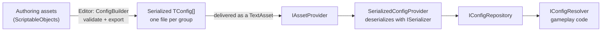

# Config

Generic runtime access to build-time-authored data. The package never knows a project's config shapes (upgrades, enemies,
buildings...): everything is generic over `TConfig`.



| Type | Role |
| --- | --- |
| `IConfigGroupRegistry` | Declares which groups exist: `Register<TConfig>(groupId, assetId, idSelector)`. |
| `IConfigProvider` | Loads a group into the repository. `SerializedConfigProvider` is the default. |
| `IConfigRepository` | The read API: `Get<T>(id)`, `GetAll<T>()`, `Contains<T>(id)`. |
| `IConfigResolver` | Ensures the group is loaded, then reads: `ResolveAsync<T>(id)`, `ResolveAllAsync<T>()`. |

A **group** is one config type delivered as one serialized array (`TConfig[]`) under one asset id. `idSelector` extracts each
entry's id; a duplicate id in a group fails the load.

## Runtime setup

```csharp compile
using System.Collections.Generic;
using System.Threading;
using Cysharp.Threading.Tasks;
using Foundation.Config;
using Foundation.DI;
using Foundation.Infrastructure.MemoryPack;
using Foundation.Serialization;
using MemoryPack;

[MemoryPackable]
public sealed partial class UpgradeConfig
{
    public string Id { get; set; }

    public int Cost { get; set; }
}

public sealed class UpgradeConfigGroups : IConfigGroupInstaller
{
    public void Install(IConfigGroupRegistry registry)
        => registry.Register<UpgradeConfig>("upgrades", "config/upgrades", config => config.Id);
}

public sealed class ConfigInstaller : IFeatureInstaller
{
    public void Install(IServiceRegistry registry)
    {
        registry.Register<MemoryPackSerializerAdapter>(ServiceLifetime.Singleton).As<ISerializer>();
        registry.UseConfigs();

        registry.RegisterBuildCallback(resolver =>
            new UpgradeConfigGroups().Install(resolver.Resolve<IConfigGroupRegistry>()));
    }
}
```

`SerializedConfigProvider` also needs an `IAssetProvider` (see [Content](content)); it reads the group's bytes from a
`TextAsset` at the registered asset id, deserializes `TConfig[]` with the `ISerializer`, and registers every entry in the
repository. Concurrent requests for one group share a single load, and the asset handle is released after the load.
`UseConfigs()` shuts the provider down with its scope. Canceling one caller stops that caller's wait, while the shared
load may continue and register the group. After provider shutdown, a late asset result is released without being registered.

Register this stack **per [game context](game-contexts)**, in the context's installers, so a context resolves its own
configs without knowing which context it is.

## Reading configs

```csharp compile
public sealed class UpgradeShop
{
    private readonly IConfigResolver _configs;

    public UpgradeShop(IConfigResolver configs) => _configs = configs;

    public async UniTask<int> CostOfAsync(string upgradeId, CancellationToken cancellationToken)
    {
        var upgrade = await _configs.ResolveAsync<UpgradeConfig>(upgradeId, cancellationToken);
        return upgrade.Cost;
    }

    public UniTask<IReadOnlyList<UpgradeConfig>> AllAsync(CancellationToken cancellationToken)
        => _configs.ResolveAllAsync<UpgradeConfig>(cancellationToken);
}
```

After a group has been loaded, `IConfigRepository.Get<T>(id)` reads it synchronously; gameplay code that runs after
startup can use that to avoid awaiting in hot paths.

## Build-time pipeline

The Editor side turns authoring assets into those serialized groups. **Content → Config → Build All Config** runs it
(and **Validate Config** runs validation only).

1. A project's authoring assets are `ScriptableObject`s that implement the marker `IConfigAuthoringSource`
   (assembly `Foundation.Content.Authoring`, so runtime code can reference the marker without the Editor pipeline).
2. `ConfigBuilder` finds every such asset, and dispatches by interface to the project's `IConfigExporter` (one per source
   type) and `IConfigValidator`s. It never names a concrete config type, so a new group needs no change in the package.
3. An exporter returns `ConfigExportGroup<T>` objects: a file name, the payload (usually a `TConfig[]`) and the entry ids.
   The build writes each group's payload, serialized in the [binary format](#the-binary-format) of the project, into
   `ConfigBuildSettings.OutputDirectory` (default `Assets/Generated/Config`).
4. Validators return `ConfigBuildError`s that the build window shows; an optional `IConfigBuildPostProcessor` runs after a
   successful build.

Register the project’s exporters and validators in an `IConfigBuildInstaller`. Assign a factory that invokes it and
creates a `ConfigBuilder` to `ConfigBuildEntryPoint.BuilderFactory` from an Editor assembly:

```csharp
public sealed class MyConfigBuildInstaller : IConfigBuildInstaller
{
    public void Install(ConfigBuildRegistry registry)
    {
        registry.RegisterExporter(new UpgradesExporter());
        registry.RegisterValidator(new UpgradesValidator());
    }
}

[UnityEditor.InitializeOnLoad]
public static class MyConfigBuildSetup
{
    static MyConfigBuildSetup()
    {
        ConfigBuildEntryPoint.BuilderFactory = CreateBuilder;
    }

    private static ConfigBuilder CreateBuilder()
    {
        var registry = new ConfigBuildRegistry();
        new MyConfigBuildInstaller().Install(registry);
        return new ConfigBuilder(new ConfigBuildSettings(), registry);
    }
}
```

The generated files must then be delivered as assets whose addresses match the `assetId` of the corresponding group.

### The binary format

The pipeline does not depend on a serialization library. `ConfigExportGroup.Serialize` takes an `ISerializer`, and the build
picks it in this order:

1. `ConfigBuildSettings.Serializer`, when the project sets it. This is where a project supplies its own format; it has to be
   the one the game's runtime `ISerializer` reads.
2. The serializer adapter installed in the project. The MemoryPack and MessagePack adapters each announce themselves to
   `ConfigSerializers` from a small editor assembly, so with exactly one of them installed nothing needs configuring.
3. Otherwise the build fails with a `NoSerializer` error that says what to do. With several adapters installed it asks for an
   explicit choice, because a file written in one format only fails when the game reads it with another. *Validate* never
   serializes, so it works without any of this.

```csharp
// In MyConfigBuildSetup.CreateBuilder, after registering with the registry:
return new ConfigBuilder(
    new ConfigBuildSettings { Serializer = new MyBinarySerializer() },
    registry);
```

The types in a payload have to suit the chosen format (for MemoryPack, `[MemoryPackable]`); the package's own data types are
covered by each adapter, see [Serialization](../adapters/serialization).

Authoring, content groups and Addressables: [Content workspace](../editor/workspace).

Output paths must be unique across every source and group in one build. Both Validate and Build reject duplicate
output file names (case-insensitively, for portable content), before any file is written.
