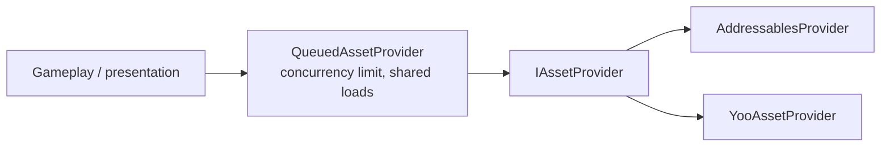

# Content and assets

`IAssetProvider` is the one contract gameplay code depends on to load, instantiate and release assets. `Foundation`
itself never references Addressables or YooAsset: those are adapters ([Addressables](../adapters/addressables),
[YooAsset](../adapters/yooasset)).

For multi-origin routing and failover during remote content synchronization, see [Content mirroring](content-mirroring).



## IAssetProvider

```csharp
UniTask<IAssetHandle<T>> LoadAssetAsync<T>(string assetId, CancellationToken ct = default) where T : UnityEngine.Object;
UniTask<IAssetInstance> InstantiateAsync(string assetId, Transform parent = null, CancellationToken ct = default);
bool ContainsAsset<T>(string assetId) where T : UnityEngine.Object;
UniTask<IPreloadHandle> PreloadAsync(IReadOnlyList<string> assetIds, IProgress<float> progress = null, CancellationToken ct = default);
```

Asset ids are strings (addresses). Every load returns a handle you **dispose** to release your reference; the provider
may share an underlying load between requests for the same asset; this depends on the provider.

| Type | Role |
| --- | --- |
| `IAssetHandle<T>` | The loaded `Asset`. `Dispose()` releases it. |
| `IAssetInstance` | An instantiated prefab. Disposing releases the instance. |
| `IPreloadHandle` | Keeps a set of ids warm until disposed, for a loading screen to prefetch. |
| `AssetHandleScope` | Owns the handles one screen or presenter loaded: `LoadAsync<T>`, `LoadComponentAsync<T>`; `Dispose` releases them all. |
| `QueuedAssetProvider` | Wraps a provider: limits concurrent asset loads (separate interactive and background lanes) and shares loads of the same address and type. `InstantiateAsync` bypasses the queue. |
| `CompositeProgress` | Merges several `IProgress<float>` reporters into one weighted 0..1 value for a progress bar. |

```csharp compile
using System;
using System.Collections.Generic;
using System.Threading;
using Cysharp.Threading.Tasks;
using Foundation.Content;
using UnityEngine;

public sealed class LoadingScreenPresenter
{
    private readonly IAssetProvider _assets;

    public LoadingScreenPresenter(IAssetProvider assets) => _assets = assets;

    public async UniTask<IPreloadHandle> PrefetchAsync(IProgress<float> progress, CancellationToken cancellationToken)
    {
        return await _assets.PreloadAsync(new[] { "enemy-ship", "explosion-vfx" }, progress, cancellationToken);
    }
}
```

A handle released too early takes its asset away from whatever still shows it. Keep the handle with the thing that shows
the asset. `AssetHandleScope` does that for a screen:

```csharp compile
public sealed class ShopScreen : IDisposable
{
    private readonly AssetHandleScope _assets;

    public ShopScreen(IAssetProvider provider) => _assets = new AssetHandleScope(provider);

    public async UniTask ShowAsync(UnityEngine.UI.Image icon, CancellationToken cancellationToken)
    {
        icon.sprite = await _assets.LoadAsync<Sprite>("icons/gold", cancellationToken);
    }

    // Closing the screen releases all resources it loaded.
    public void Dispose() => _assets.Dispose();
}
```

## Lifetime rules

- **Every handle has an owner.** The owner is whoever shows the asset, and it disposes the handle when it is done.
- **Do not release from gameplay features.** Lifetime policy belongs to infrastructure, the asset provider and the UI
  layer that opens and closes screens. Features ask for an asset and give the handle back.
- **Requests can share a load.** `QueuedAssetProvider` shares a load for the same address and type while at least one
  handle remains alive. The wrapped provider can also have its own caching policy.
- **Sharing is per address and type.** Requests for one address share a load only when they ask for the same type. The
  same address asked for as another type (a `Sprite` cut from a `Texture2D` sheet, for example) loads on its own.
  `PreloadAsync` loads as `UnityEngine.Object`, so a later typed request for the same address takes its own handle; to
  share one, preload with `PreloadInBackgroundAsync<T>` using the type the game will request.
- **Prefer the queue.** Register `QueuedAssetProvider` as the provider code actually calls to bound asset loads; instantiation bypasses the queue.
  `PreloadInBackgroundAsync<T>` loads ahead of time through the background lane; pass the type the game will ask for
  later.

## Main thread

Call `IAssetProvider` and dispose the handles it returns on the Unity main thread. The interface does not promise thread
safety, and a provider is not required to handle concurrent calls. `QueuedAssetProvider` shows why: its lanes limit how
many loads run at once, not which thread calls it, and its shared-load table is not synchronized.

A handle owns one reference. `LoadAssetAsync` returns it; dispose it once when the owner stops using the asset. The
provider releases the underlying load after the last reference goes. Disposing the provider releases the loads it has
registered, even if handles for them are still alive. After that, disposing those handles releases nothing.

`InstantiateAsync` follows the same rule. Disposing `IAssetInstance` destroys its GameObject and releases the prefab
reference; destroying the GameObject first releases that reference too. Disposing `IPreloadHandle` releases every asset
the preload acquired. When a preload fails, the provider releases the handles it already acquired and rethrows the
failure.

## Registering

Register a backend and an `IObjectSpawner`. `IObjectSpawner` is the object creation contract; `AsyncObjectSpawner` can
set Unity's integration budget when configured. This example supplies that budget explicitly:

```csharp compile
using Foundation.DI;
using Foundation.Infrastructure.Addressables;
using Foundation.Logging;
using Foundation.Spawning;

public sealed class ContentInstaller : IFeatureInstaller
{
    public void Install(IServiceRegistry registry)
    {
        registry.Register<IObjectSpawner>(_ => new AsyncObjectSpawner(AsyncObjectSpawner.DefaultIntegrationTimeMS), ServiceLifetime.Singleton);
        registry.Register<IAssetProvider>(
            resolver => new QueuedAssetProvider(
                new AddressablesProvider(resolver.Resolve<Foundation.Logging.IAppLogger>(), resolver.Resolve<IObjectSpawner>())),
            ServiceLifetime.Singleton);
    }
}
```

Code then depends only on `IAssetProvider`. The queue's concurrency limits are constructor parameters
(`interactiveConcurrency`, `backgroundConcurrency`).

## Content delivery is separate from authoring

Addressables labels and groups describe **delivery**. They do not define gameplay schemas or authoring rules. The usual
pipeline is: authored source → validation → compiled runtime data ([Config](config)) → delivered through
`IAssetProvider` → runtime repositories. Content validators and builders should not contain gameplay loading logic.
