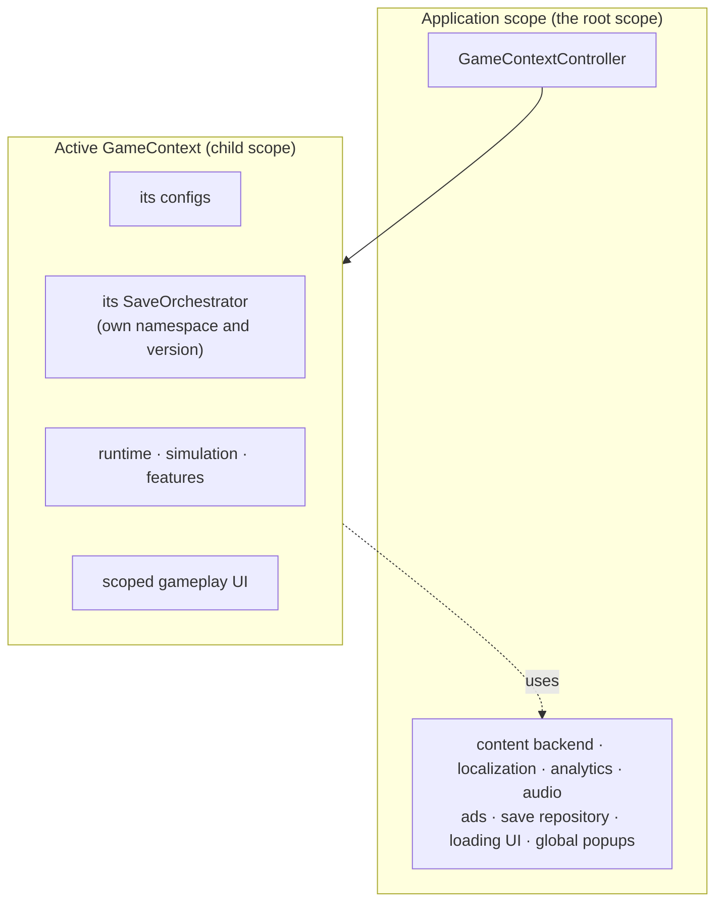
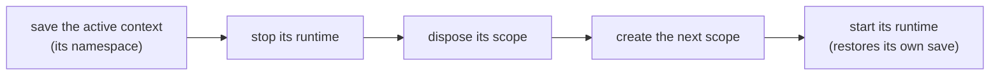

# Game contexts

A **game context** is one self-contained game inside the application: the main game, a full seasonal event, a separate
mode. Exactly one is active at a time. It owns that game's runtime (state, simulation, features, tutorial, scoped UI,
its configs, its save namespace) and *uses* the application's shared infrastructure rather than owning any of it.



Planned seasonal events are not screens or flags on top of the main game: they are separate games with their own
economy, progression and save. Modeling them as flags inside one scope would mean several games' services in one
container and several games' segments in one save file.

## The pieces

| Type | Role |
| --- | --- |
| `GameContextId` | The identity of a context. It keys the catalog and is the value stored for the last active context, so renaming one loses that selection; the save slot is set separately in `GameContextSaveProfile`. |
| `GameContextDefinition` | Id, `GameContextSaveProfile` and the `IFeatureInstaller` list that composes the scope. A new context is a new definition, not new lifecycle classes. |
| `GameContextSaveProfile` | The save namespace, the slot, and the context's own version and migrations. `Legacy(...)` pins the slot to `SaveSlot.Default`. |
| `IGameContextCatalog` | Which contexts this build can run, and the fallback context (usually the main game). |
| `IGameContextRuntime` | The one contract a context registers in its scope. `StartAsync` takes it to "playable"; `StopAsync` quiesces it. |
| `IGameContextScopeFactory` | Builds the child scope. `VContainerGameContextScopeFactory` is the VContainer one. |
| `IGameContextController` | The lifecycle: `EnterAsync`, `EnterStartupContextAsync`, `ReloadActiveAsync`, `ResetActiveAsync`, `ExitActiveAsync`. |
| `IGameContextSelectionStore` | Remembers the last active context outside any save namespace, readable before any context exists. |

## A minimal context

```csharp compile
using System.Collections.Generic;
using System.Threading;
using Cysharp.Threading.Tasks;
using Foundation.DI;
using Foundation.GameContexts;
using Foundation.Infrastructure.VContainer;
using Foundation.Lifecycle;
using Foundation.Save;
using Foundation.Scheduling;

public sealed class Counter
{
    public int Value { get; set; }
}

public sealed class MainGameRuntime : IGameContextRuntime
{
    private readonly SaveOrchestrator _save;
    private readonly Counter _counter;

    public MainGameRuntime(SaveOrchestrator save, Counter counter)
    {
        _save = save;
        _counter = counter;
    }

    public async UniTask StartAsync(CancellationToken cancellationToken = default)
    {
        // The scope exists: bring the game to "playable". Restore the save, start simulation, open the UI.
        await _save.LoadAsync(cancellationToken);
    }

    public UniTask StopAsync(CancellationToken cancellationToken = default)
    {
        // Quiesce what StartAsync started. The controller saves before calling this.
        return UniTask.CompletedTask;
    }
}

public sealed class MainGameInstaller : IFeatureInstaller
{
    public void Install(IServiceRegistry registry)
    {
        registry.RegisterScopedScheduler();
        registry.Register<Counter>(ServiceLifetime.Singleton);

        // The orchestrator is built from this context's own save profile.
        registry.Register(
            resolver =>
            {
                var profile = resolver.Resolve<GameContextSaveProfile>();
                return new SaveOrchestrator(
                    resolver.Resolve<IReadOnlyList<IFeatureSaveModule>>(),
                    resolver.Resolve<ISaveRepository>(),
                    resolver.Resolve<ISaveSerializer>(),
                    profile.SaveVersion,
                    profile.Migrations,
                    profile.SlotId);
            },
            ServiceLifetime.Singleton);

        registry.Register<MainGameRuntime>(ServiceLifetime.Singleton).As<IGameContextRuntime>();
    }
}

public static class MainGame
{
    public static readonly GameContextId Id = new("main");

    public static GameContextDefinition CreateDefinition() => new(
        Id,
        GameContextSaveProfile.Legacy("main", saveVersion: 1),
        new IFeatureInstaller[] { new MainGameInstaller() },
        displayName: "Main game");
}
```

In the application scope, register the layer and enter the startup context from the entry point:

```csharp compile
public sealed class GameContextsInstaller : IFeatureInstaller
{
    public void Install(IServiceRegistry registry)
    {
        registry.RegisterInstance<IGameContextSelectionStore>(new PlayerPrefsGameContextSelectionStore());
        registry.RegisterInstance<IGameContextCatalog>(
            new GameContextCatalog(new[] { MainGame.CreateDefinition() }, MainGame.Id));
        registry.Register<VContainerGameContextScopeFactory>(ServiceLifetime.Singleton).As<IGameContextScopeFactory>();
        registry.Register(
            resolver => new GameContextController(
                resolver.Resolve<IGameContextCatalog>(),
                resolver.Resolve<IGameContextScopeFactory>(),
                resolver.Resolve<IGameContextSelectionStore>(),
                resolver.TryResolve<ISaveRepository>(out var saveRepository) ? saveRepository : null,
                resolver.TryResolve<Foundation.Messaging.IEventBus>(out var eventBus) ? eventBus : null,
                resolver.TryResolve<Foundation.Logging.IAppLogger>(out var logger) ? logger : null),
            ServiceLifetime.Singleton).As<IGameContextController>();
    }
}

public sealed class AppEntryPoint : RootEntryPoint
{
    private readonly IGameContextController _contexts;

    public AppEntryPoint(IGameContextController contexts) => _contexts = contexts;

    protected override async UniTask RunAsync(CancellationToken cancellation)
        => await _contexts.EnterStartupContextAsync(cancellation);
}
```

`GameContextController` also takes an optional `ISaveRepository`, `IEventBus` and `IAppLogger`. A registered repository
lets `ResetActiveAsync` clear the save namespace, the event bus publishes `GameContextEnteredEvent` and
`GameContextExitedEvent`, and the logger records transitions and failures.

A scope built by the VContainer factory contains the `GameContextDefinition` and `GameContextSaveProfile` of its context
as injectable instances, for the rare case a feature needs the namespace by name. Gameplay code should not inspect
context ids: it resolves `IConfigResolver` and `SaveOrchestrator` from its own scope and gets this context's.

## The transition pipeline

When switching from an active context or reloading it, the controller follows this order:



Saving happens while the outgoing runtime is still fully alive, so the snapshot is the state the player actually left.
Nothing is written after the scope is gone. Transitions are serialized, so a second enter cannot tear down a half-built
scope. The first entry has no outgoing context to save. Entering the active context again returns it without a transition.
Reset follows a different path: it exits without saving and clears the save namespace before re-entry.

Transitions preserve the outgoing context when its save fails and attempt recovery after a failed start:

- A save that fails (or a transition canceled before its save completed) leaves the outgoing context running untouched,
  and the transition fails. Nothing played since the last save is thrown away.
- Once saving completes and teardown begins, caller cancellation does not interrupt the transition; disposing the
  controller can still stop it. A scope-disposal failure clears the active reference, publishes the exit report, and
  fails the transition.
- A context that throws while starting is disposed and not left active. A switch tries the context the player came from,
  then a distinct fallback; reload/reset only try the distinct fallback. The transition still fails with the original
  error; if all recovery attempts fail, there is no active context.

Entered and exited events are reports: a failing subscriber is logged and never fails a transition.

`ResetActiveAsync` exits **without** saving, writes an empty save over the namespace, then re-enters: every feature
comes up on its constructed defaults. The empty save is stamped later than saves this orchestrator has loaded or written.
This does not account for clock differences between devices, so a cloud copy the context has not seen may still have a
later timestamp.

## Startup and fallback

`ResolveStartupContextId()` returns the persisted selection when it is still in the catalog, and the catalog's fallback
otherwise. An unavailable persisted id therefore selects the fallback, but the fallback's own startup can still fail.

## Dependency rules

- Application-owned services must not depend on context-owned ones. A child scope sees its parent, never the reverse, so
  this direction fails at resolve time.
- Context-owned code may depend on application services freely.
- The application scope must register **no** `IFeatureSaveModule`. A collection parameter receives the registrations of
  the parent scopes too, so a module registered there would be captured into every context's save. Application-level
  persistence belongs in a small dedicated store, the way `IGameContextSelectionStore` and `ILocalePreferenceStore`
  work.
- Context-owned code that subscribes to an application-owned event bus must dispose its subscription when it stops.

A DI adapter must keep two behaviors for this to work: a singleton registered in a child scope is owned and disposed by
that child, and entry points registered in a child scope are started when it is built and stopped when it is disposed.

## Described contexts and modules

A context can be *described* before its code is loaded: a `GameContextDescriptor` names the id, the save profile, the
`GameModuleId`s it is made of and the UTC window it can be entered in (a season). `ModularGameContextController` loads
those modules before entering, refreshes descriptors from a downloaded config, and enters the fallback instead of a
context outside its window. See [Game modules](game-modules).

## Debug service

`GameContextDebugService` describes the active context and its namespace, enters, reloads or resets a context. It is
compiled for the Editor and for players built with `FOUNDATION_DEVELOPMENT`; release profiles should omit that define so
the service is absent from production assemblies.

## Not implemented on purpose

Suspend/resume, context overlays and nested contexts are not implemented. The controller supports one active context and
serialized transitions between contexts.
