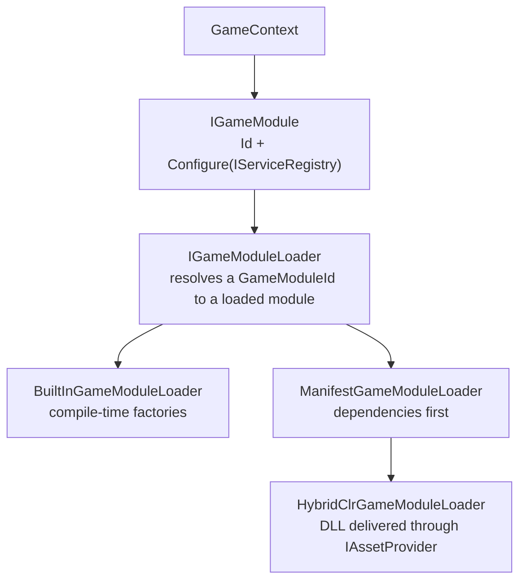

# Game modules and hot update

A **game module** is a loadable unit of DI composition. It provides a common composition contract for a
[game context](game-contexts), whether its code is built into the player or downloaded as a hot-update assembly.



| Type | Role |
| --- | --- |
| `GameModuleId` | A module's logical identity. Not an assembly name or an address: a loader decides what either means. |
| `IGameModule` | `Id` plus `Configure(IServiceRegistry)`. Shaped like `IFeatureInstaller` on purpose. |
| `IGameModuleLoader` / `IGameModuleHandle` | `LoadAsync(id)` returns a handle whose `Module` is the strongly typed `IGameModule`. The handle represents loader-owned resources; disposing it does not imply that a loaded assembly can be unloaded. |
| `BuiltInGameModuleLoader` | Resolves modules from compile-time factories. No dynamic loading at all. |
| `GameModuleManifest` | Module ids mapped to delivery addresses and dependencies; validated (no unknown dependency, no cycle). |
| `ManifestGameModuleLoader` | Loads a module after its dependencies, reading the manifest from an `IGameModuleManifestSource` that may refresh it from a downloaded config first. |
| `CachedGameModuleLoader` | Loads each module once per process (a hot-update assembly cannot be loaded twice). |
| `GameModuleFeatureInstaller` | Wraps a loaded module as an `IFeatureInstaller`, so a scope installs it through the same call as a static installer. |

## A built-in module

```csharp compile
using System;
using System.Collections.Generic;
using System.Threading;
using Cysharp.Threading.Tasks;
using Foundation.DI;
using Foundation.GameModules;

public sealed class ChallengeModule : IGameModule
{
    public GameModuleId Id => new("challenge");

    public void Configure(IServiceRegistry registry)
    {
        // Register this mode's dependencies, just as a feature installer would.
        registry.Register<ChallengeRules>(ServiceLifetime.Singleton);
    }
}

public sealed class ChallengeRules
{
}

public static class ModuleLoading
{
    public static IGameModuleLoader CreateLoader()
    {
        return new BuiltInGameModuleLoader(new Dictionary<GameModuleId, Func<IGameModule>>
        {
            [new GameModuleId("challenge")] = () => new ChallengeModule(),
        });
    }

    public static async UniTask<IFeatureInstaller> LoadInstallerAsync(
        IGameModuleLoader loader,
        CancellationToken cancellationToken)
    {
        using var handle = await loader.LoadAsync(new GameModuleId("challenge"), cancellationToken);
        return new GameModuleFeatureInstaller(handle.Module);
    }
}
```

`BuiltInGameModuleLoader` rejects a factory that returns `null` or a module whose own `Id` differs from the requested
id, with a `GameModuleLoadException`.

## A manifest

`GameModuleManifestEntry(id, assemblyAddress, dependencies)` describes one module. Keep the manifest in a config, not in
code: a row holds the module id, the address of its assembly bytes and the modules that must load first. Adding a mode,
redirecting an assembly address or opening a seasonal event can then be handled as a content change, though new code may
still need a matching player build or AOT changes. A new or redirected module reaches a running client when its loader
is built, which normally means the next launch.

`ManifestGameModuleLoader` builds its assembly loader once, using the addresses available after the initial refresh.
Later manifest reads can change dependency relationships, but changing an address or adding a module after that loader
is built does not update its address table. Plan a new loader or restart for those changes; a process-wide cached module
also remains resident until restart.

```csharp compile
public static class ManifestExample
{
    public static GameModuleManifest Create()
    {
        return new GameModuleManifest(new[]
        {
            new GameModuleManifestEntry(new GameModuleId("shared"), "modules/shared"),
            new GameModuleManifestEntry(
                new GameModuleId("winter-event"),
                "modules/winter-event",
                new[] { new GameModuleId("shared") }),
        });
    }
}
```

Keep in code only what has to be compiled: a built-in fallback context and anything tied to code, such as a save
migration.

## Contexts made of modules

A `GameContextDescriptor` names the `GameModuleId`s a context is made of, plus its id, save profile, display name,
season and availability window. `ModularGameContextController` wraps the plain controller for such contexts:

- it refreshes described contexts from an `IGameContextDescriptorSource` (for example a downloaded config);
- it enters the fallback instead of a context outside its availability window, judged by an `IGameContextClock`;
- it loads the context's modules through the `IGameModuleLoader` and installs them with `GameModuleFeatureInstaller`;
- it keeps exactly the module handles the running context uses;
- `IGameContextTransitionHooks` lets a project add steps around a switch (content download, runtime metadata, shared
  presentation, a loading bar).

`MaterializedGameContextCatalog` holds the descriptors plus the definitions built once their modules are loaded; a
definition is published while its modules are loaded and removed after its context exits. Every context built this way
has a `GameContextSeason` in its scope saying which season it is.

## Hot update with HybridCLR

`Foundation.Infrastructure.HybridClr` is the one loader backed by
[HybridCLR](https://hybridclr.doc.code-philosophy.com/). It compiles only when `com.code-philosophy.hybridclr` is
installed.

- `HybridClrGameModuleLoader(assetProvider, sources, verifier)` resolves a `GameModuleId` to an assembly address, loads
  the bytes through the existing [`IAssetProvider`](content) (a `TextAsset`, like any other delivered asset), loads the
  assembly, finds the single `IGameModule` implementation by type scan and constructs it. That scan is the only
  reflection in the module-loading chain.
- `HybridClrModuleSource(moduleId, assemblyAddress)` is the mapping; the project decides what its addresses look like.
- `HybridClrAotMetadataPreloader` loads supplemental AOT metadata for an explicit list of AOT assemblies. Calls are
  serialized, successful loads are not repeated, and a failed or canceled load can be retried. It is safe to call before
  every module load. Produce the list with HybridCLR's own tooling
  (`HybridCLR/Generate/AOTGenericReference`).
- **Signed assemblies.** Downloaded code is code you run. `HotUpdateSignature` wraps assembly bytes with an RSA
  signature (SHA-256, PKCS#1 v1.5); the build signs with a private key that never ships and the player verifies with the
  public key compiled into its AOT code. You can pass an `IHotUpdateAssemblyVerifier` (`RsaHotUpdateAssemblyVerifier`) to the
  loader and the preloader. The verifier is optional: without one, the loader does not check authenticity and executes any
  loadable assembly at the address. Omitting the verifier is supported, but a compromised or untrusted source can deliver
  attacker-controlled code for execution. For network delivery, use a verifier unless the project deliberately accepts
  that risk. The signature proves that the bytes come from the build key. It names no version, so a build signed earlier
  verifies too, which is intended: the release
  configuration decides which build a client may run, and it must be served over HTTPS so it cannot be swapped on the way.
  The same verifier can check supplemental AOT metadata.

### What it does not do

- **No physical unload.** The HybridCLR loader releases the `IAssetProvider` handle after copying/verifying the bytes,
  before `Assembly.Load`; `Dispose()` on its returned `IGameModuleHandle` is currently a no-op. The loaded assembly and
  its types stay resident for the process lifetime, because Community HybridCLR cannot unload an IL2CPP-hosted assembly.
  The loader keeps track of an assembly even if cancellation or module creation fails after loading. A retry reuses the
  same assembly; loading different bytes for the same module requires restarting the process.
- **No versioning policy.** Which address a module maps to, whether it is local or remote, and how a new version rolls
  out are the project's decisions.
- **No MonoBehaviour handling.** A hot-update `MonoBehaviour` on an Addressable prefab works because Addressables builds
  prefabs into asset bundles; the assembly must simply be loaded before the prefab is instantiated.

For an optional signed retry of one assembly address across content mirrors, see
[Content mirroring](content-mirroring#integrations).

### Dependency direction

`Foundation` never references HybridCLR or any hot-update assembly. A hot-update assembly may depend on `Foundation` for
the `IGameModule` contract, and `Foundation` must never depend on a concrete type from a hot-update assembly.
