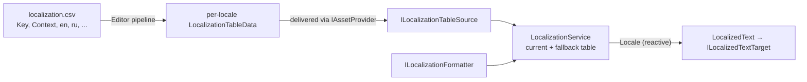

# Localization

Locale selection, key lookup, fallback, formatting and locale-change notification. Everything is part of `Foundation`;
no localization or text-rendering library is required. A project supplies three small pieces: where tables come from,
how a template is formatted, and where the chosen locale is remembered.



| Type | Role |
| --- | --- |
| `LocaleId`, `LocalizationKey`, `LocalizationArguments` | Value types. `LocaleId` compares case-insensitively and knows its `Language` (`en` of `en-US`). A string converts implicitly to `LocalizationKey`. |
| `LocalizationSettings` | The supported locales and the fallback locale. `TryResolveSupported` maps `en-GB` to `en` when only `en` is supported. |
| `ILocalizationTableSource` | Loads one locale's `LocalizationTable`. |
| `ILocalizationFormatter` | Fills a template with named arguments. `string.Format` needs an adapter that maps those names to positional arguments; projects can also use SmartFormat or a custom formatter. |
| `ILocalePreferenceStore` | Persists the chosen locale (`TryLoad`, `Save`). `PlayerPrefsLocalePreferenceStore` is the built-in one (PlayerPrefs, key `settings.locale` by default; `TryLoadSavedLocale` reads it before any service exists). |
| `ILocalizationService` / `LocalizationService` | Owns the current and fallback table; `Format`, `GetTemplate`, `SetLocaleAsync`, and the reactive `Locale`. |

## Building a service

```csharp compile
using System;
using System.Collections.Generic;
using System.Globalization;
using System.Threading;
using Cysharp.Threading.Tasks;
using Foundation.Content;
using Foundation.DI;
using Foundation.Lifecycle;
using Foundation.Localization;
using Foundation.Logging;
using Foundation.Serialization;
using Foundation.UI.UGui;
using UnityEngine;
using UnityEngine.UI;

public sealed class AssetLocalizationTableSource : ILocalizationTableSource
{
    private readonly IAssetProvider _assets;
    private readonly ISerializer _serializer;

    public AssetLocalizationTableSource(IAssetProvider assets, ISerializer serializer)
    {
        _assets = assets;
        _serializer = serializer;
    }

    public async UniTask<LocalizationTable> LoadAsync(LocaleId locale, CancellationToken cancellationToken = default)
    {
        using var handle = await _assets.LoadAssetAsync<TextAsset>($"localization/{locale}", cancellationToken);
        return LocalizationTable.FromData(_serializer.Deserialize<LocalizationTableData>(handle.Asset.bytes));
    }
}

public sealed class NamedPlaceholderFormatter : ILocalizationFormatter
{
    public string Format(string template, IReadOnlyDictionary<string, object> arguments)
    {
        var result = template;
        foreach (var pair in arguments)
            result = result.Replace("{" + pair.Key + "}", Convert.ToString(pair.Value, CultureInfo.CurrentCulture));

        return result;
    }
}

public sealed class PlayerPrefsLocaleStore : ILocalePreferenceStore
{
    private const string Key = "locale";

    public bool TryLoad(out LocaleId locale)
    {
        var stored = PlayerPrefs.GetString(Key, string.Empty);
        locale = string.IsNullOrEmpty(stored) ? default : new LocaleId(stored);
        return !locale.IsEmpty;
    }

    public void Save(LocaleId locale) => PlayerPrefs.SetString(Key, locale.Value);
}

public sealed class LocalizationInstaller : IFeatureInstaller
{
    public void Install(IServiceRegistry registry)
    {
        var settings = new LocalizationSettings(
            new[] { new LocaleId("en"), new LocaleId("ru") }, fallbackLocale: new LocaleId("en"));
        registry.RegisterInstance(settings);
        registry.Register<AssetLocalizationTableSource>(ServiceLifetime.Singleton).As<ILocalizationTableSource>();
        registry.Register<NamedPlaceholderFormatter>(ServiceLifetime.Singleton).As<ILocalizationFormatter>();
        registry.Register<PlayerPrefsLocaleStore>(ServiceLifetime.Singleton).As<ILocalePreferenceStore>();
        registry.Register(
            resolver => new LocalizationService(
                resolver.Resolve<ILocalizationTableSource>(),
                resolver.Resolve<ILocalizationFormatter>(),
                settings,
                resolver.TryResolve<IAppLogger>(out var logger) ? logger : null),
            ServiceLifetime.Singleton).As<ILocalizationService>();
        registry.RegisterEntryPoint<LocalizationStartup>();
    }
}

public sealed class LocalizationStartup : IAsyncStartableEntryPoint
{
    private readonly ILocalizationService _localization;
    private readonly ILocalePreferenceStore _store;

    public LocalizationStartup(ILocalizationService localization, ILocalePreferenceStore store)
    {
        _localization = localization;
        _store = store;
    }

    public UniTask StartAsync(CancellationToken cancellationToken)
    {
        var locale = _store.TryLoad(out var saved) ? saved : new LocaleId(CultureInfo.CurrentCulture.TwoLetterISOLanguageName);

        // Falls back to the fallback locale when the requested one is unsupported or fails to load.
        return _localization.InitializeAsync(locale, cancellationToken);
    }
}
```

`LocalizationService` implements both `ILocalizationService` and `ILocalizationSource`. The example registers only
`ILocalizationService`. If the project also uses `LocalizationResolver` for asynchronous lookup, add
`.As<ILocalizationSource>()` to that same registration.

## Looking up and formatting

```csharp compile
public sealed class GoldLabelText
{
    private readonly ILocalizationService _localization;

    public GoldLabelText(ILocalizationService localization) => _localization = localization;

    public string Describe(int amount)
    {
        var arguments = new LocalizationArguments(new Dictionary<string, object> { ["amount"] = amount });
        return _localization.Format("hud.gold_label", arguments);
    }
}
```

- `GetTemplate(key)` returns the raw template; `Format(key, arguments)` fills it. With no arguments, the template is
  returned as is.
- Lookup tries the current table, then the fallback table. If neither table contains the key, lookup returns
  `[MISSING:<key>]`. A missing key does not return `null` or throw; the placeholder makes the missing translation
  visible in the UI.
- `LocalizationKeys` (generated from the CSV) gives call sites constants instead of raw strings.

## Switching locale

`SetLocaleAsync(locale)` returns `false` if the locale is unsupported, the table source fails to load the table, or it
returns no table. Cancellation propagates. The service replaces its tables only after loading them, so a load failure
leaves the running locale untouched.
It then supplies the matching `CultureInfo` to an `ILocalizationCultureAware` formatter before publishing `Locale`.
If the formatter throws while changing culture, the exception propagates after the tables have changed and before the
locale value is published; the service does not roll back that change. Subscribe to refresh culture-sensitive UI:

```csharp compile
public sealed class LanguageMenu : IDisposable
{
    private readonly ILocalizationService _localization;
    private readonly ILocalePreferenceStore _store;
    private readonly IDisposable _subscription;

    public LanguageMenu(ILocalizationService localization, ILocalePreferenceStore store)
    {
        _localization = localization;
        _store = store;
        _subscription = _localization.Locale.Subscribe(locale => UnityEngine.Debug.Log($"Locale is now {locale}"));
    }

    public async UniTask ChooseAsync(string localeCode, CancellationToken cancellationToken)
    {
        var locale = new LocaleId(localeCode);
        if (await _localization.SetLocaleAsync(locale, cancellationToken))
            _store.Save(locale);
    }

    public void Dispose() => _subscription.Dispose();
}
```

## Text on screen: `LocalizedText`

`LocalizedText` (in `Foundation.UI.UGui`) sits on a UI object, holds a localization key and optional arguments, and
re-renders whenever the locale changes. It is renderer-agnostic: the text goes through
`ILocalizedTextTarget.SetText(string)`, one method that **your project implements** for the renderer it uses
(TextMeshPro, UniText, ...). The package depends on none of them.

```csharp compile
public sealed class UiTextTarget : MonoBehaviour, ILocalizedTextTarget
{
    [SerializeField] private Text text;

    public void SetText(string value) => text.text = value;
}
```

Reference the component in `LocalizedText.textTarget` in the inspector and set a key there or with `SetKey`. Set
arguments in the inspector or with `SetArgument` and `SetArguments`. `LocalizedText` receives its `ILocalizationService` through
`IServiceResolverClient`, so it needs a scope whose injector binds it (a popup opened by the router, a pooled instance,
or a scene object injected by your composition root).

`FoundationButton` states can carry a localization key and arguments the same way.

## SmartFormat

`Foundation.Infrastructure.SmartFormat` is an optional `ILocalizationFormatter` on
[SmartFormat](https://github.com/axuno/SmartFormat) (NuGet `SmartFormat`, 3.6.1 tested). It is switched on by
`FOUNDATION_SMARTFORMAT`, which **Finish Setup** sets when the DLL is in the project. `UseSmartFormat` registers it, and
`UseLocalization<TTableSource>` is the overload that leaves the formatter to you:

```csharp compile
using Foundation.DI;
using Foundation.Infrastructure.SmartFormat;
using Foundation.Localization;
using SmartFormat.Extensions;

public sealed class SmartFormatLocalizationInstaller : IFeatureInstaller
{
    public void Install(IServiceRegistry registry)
        => registry
            .UseLocalization<AssetLocalizationTableSource>(
                new LocalizationSettings(new[] { new LocaleId("en"), new LocaleId("ru") }, fallbackLocale: new LocaleId("en")))
            .UseSmartFormat(formatter => formatter.RemoveFormatterExtension<PluralLocalizationFormatter>());
}
```

The formatter implements `ILocalizationCultureAware`, so plural and conditional forms follow the locale the service
switched to. `LocalizationCsvValidator` checks localization keys and placeholders, but it does not parse SmartFormat
templates. Calls without arguments bypass the formatter. If formatting with arguments throws, `LocalizedText` logs the
error and displays the raw template. To catch SmartFormat syntax errors during content validation, add a validator that
uses the same formatter configuration as the runtime. The callback adjusts the SmartFormat pipeline once (here it drops the plural extension,
as a project that uses only conditional word forms would); without it the SmartFormat defaults apply. Without the
adapter nothing changes: the formatter stays your own registration.

## Authoring: the CSV pipeline

```text
Google Sheets / Excel → UTF-8 CSV → validation → generated LocalizationKeys → per-locale binaries → Addressables → IAssetProvider
```

The CSV format is `Key,Context,<locale>,<locale>,...`. `Key` and `Context` are metadata; **every other column is a
locale**, so adding a language is adding a column, not changing code. The Editor pipeline lives in
`Foundation.Content.Editor` and has no third-party dependency (the CSV reader is built in; the binaries are written
through the [serializer of the content build](config#the-binary-format)):

| Type | Role |
| --- | --- |
| `LocalizationCsvReader` / `LocalizationCsvSource` | Reads `localization.csv` into a `LocalizationDocument`. |
| `LocalizationCsvValidator` | Checks for missing and duplicate keys before export. |
| `LocalizationPlaceholders` | Validates that `{name}` placeholders agree across locales for one key. |
| `LocalizationCsvExporter` | Produces one `LocalizationTableData` per locale column. |
| `LocalizationKeysGenerator` | Writes `LocalizationKeys` and `LocalizationLocales` source from the key column. |
| `LocalizationBuildSettings` | Your output directory, namespace and CSV path. |

Do not hardcode supported languages in importer code, and do not hardcode player-facing strings in C#.

## Layout and longer text

Localization correctness includes layout. When a screen carries significant localized text, look at it in a locale
likely to produce longer strings: clipping, wrapping, button growth and number-plus-suffix combinations are not visible
in English alone.
