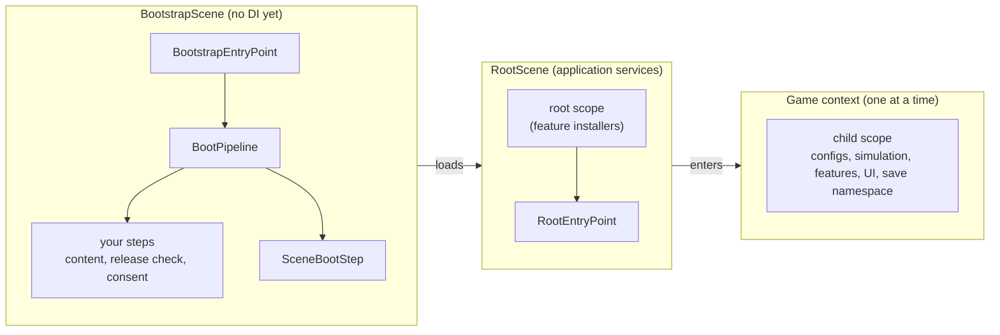

# Application composition

This page explains how to connect Foundation layers and where project code belongs. Include the layers you need:
lower-level services can be used independently of the full application lifecycle. For the complete setup, a project
provides boot steps, installers and game contexts.



## 1. Boot: before the container exists

`BootstrapEntryPoint` is the component of the first scene. Used as it is, it loads the scene at `rootSceneIndex`. A
project derives from it and lists what must happen first. Boot steps run before any DI container exists, so they
construct their own dependencies.

`IBootStep` has a `Name` (the profiler marker is `Foundation.Boot.<Name>`), a `Weight` (how many curtain steps it fills;
`0` leaves the bar alone) and `RunAsync`, which reports progress from 0 to 1 and returns `Continue` or `Stop`.
`BootPipeline` runs the steps in order and fills the bar through an `ILoadingCurtain`. The bootstrap calls
`OnBootStopped` when a step intentionally returns `Stop`; exceptions from `OnBeforeBoot` or a step go to `OnBootFailed`.

```csharp compile
using System;
using System.Collections.Generic;
using System.Threading;
using Cysharp.Threading.Tasks;
using Foundation.DI;
using Foundation.GameContexts;
using Foundation.Lifecycle;
using UnityEngine;

public sealed class MinimalCurtain : ILoadingCurtain
{
    public void BeginReload()
    {
    }

    public void CancelReload()
    {
    }

    public UniTask CompleteAsync() => UniTask.CompletedTask;

    public void AdvanceStep(string status)
    {
    }

    public void SetTransitionProgress(float progress)
    {
    }

    public void AdvanceWeightedStep(int weight, string status)
    {
    }

    public void SetWeightedStepFraction(float fraction, int weight, string status)
    {
    }

    public void ShowFatalError(string title, string description) => Debug.LogError($"{title}: {description}");

    public void ShowWaitingForConnection(string title, string description)
    {
    }

    public void ClearWaitingForConnection()
    {
    }
}

public sealed class MyBootstrap : BootstrapEntryPoint
{
    private readonly MinimalCurtain _curtain = new();

    protected override ILoadingCurtain Curtain => _curtain;

    protected override void OnBeforeBoot() => Debug.Log("Boot starts");

    protected override IReadOnlyList<IBootStep> CreateSteps() => new IBootStep[]
    {
        new DelegateBootStep("Consent", 1, (progress, cancellationToken) => AskConsentAsync(cancellationToken)),
        new SceneBootStep(RootSceneIndex),
    };

    protected override void OnBootFailed(Exception exception) => _curtain.ShowFatalError("Boot failed", exception.Message);

    protected override void OnBootStopped() => Debug.Log("Boot stopped by a step that handled its own result");

    private static UniTask AskConsentAsync(CancellationToken cancellationToken) => UniTask.CompletedTask;
}
```

Ready-made steps:

| Step | Where | Does |
| --- | --- | --- |
| `SceneBootStep` | core | Loads the root scene. Place it last in the configured steps. |
| `DelegateBootStep` | core | Wraps your own phase in a delegate; no class needed. |
| `ContentStartupBootStep` | [Addressables adapter](../adapters/addressables) | Initializes content offline-first, runs an optional gate (the release check), and downloads what is missing. With `ContentStartupStrategy.Standard` it only initializes Addressables and runs the gate. |
| `YooAssetContentStartupBootStep` | [YooAsset adapter](../adapters/yooasset) | The same phase for a host-mode YooAsset package, with the same strategy choice. |

A step can end the boot on purpose by returning `BootStepOutcome.Stop` (a required update, for example); the bootstrap
reports this through `OnBootStopped`, not `OnBootFailed`. A root-scene load that cannot start throws and reaches
`OnBootFailed`. The pipeline outlives the bootstrap scene: loading the root scene unloads it, and the last steps still finish.
The pipeline runs steps in the order supplied; it does not enforce the scene step's position.

## 2. The root scope: application services

A scene component derives from `VContainerRootScope<TEntryPoint>` (or your container's equivalent) and returns the
project's `IFeatureInstaller`s. An installer is the unit of extension: it gets an `IServiceRegistry` and registers what
one feature needs, never mentioning the container. Application-owned services go here: the content provider, localization,
audio, analytics, ads, the save repository. Anything that belongs to a running game goes into its context instead.

Scene references that the container cannot create (UI roots, the loading curtain) are bound in `PrebindActions`.

```csharp compile
using Foundation.Audio;
using Foundation.Infrastructure.VContainer;
using Foundation.Messaging;
using Foundation.Pooling;

public sealed class AppEntryPoint : RootEntryPoint
{
    private readonly IGameContextController _contexts;

    public AppEntryPoint(IGameContextController contexts) => _contexts = contexts;

    protected override async UniTask RunAsync(CancellationToken cancellation)
        => await _contexts.EnterStartupContextAsync(cancellation);
}

public sealed class AppScope : VContainerRootScope<AppEntryPoint>
{
    [SerializeField] private Transform uiRoot;

    protected override IReadOnlyList<IFeatureInstaller> FeatureInstallers => new IFeatureInstaller[]
    {
        new PoolingInstaller(),
        new AudioInstaller(new IAudioChannelDefinition[] { new AudioChannelDefinition("ui") }),
    };

    protected override void PrebindActions(IServiceRegistry registry)
    {
        registry.RegisterMessaging();
        registry.RegisterInstance(uiRoot);
    }
}
```

The entry point derives from `RootEntryPoint`. Its `RunAsync` is the startup sequence and normally ends with
`IGameContextController.EnterStartupContextAsync`. The example also needs a project-specific registration for
`IGameContextController` and its dependencies; these are omitted from `AppScope`. A scope that is disposed underneath it (leaving Play Mode, shutdown)
ends it quietly instead of reporting a failure.

## 3. Game contexts: one game at a time

A game context is a self-contained game with its own scope, configs and save namespace; see [Game
contexts](../app/game-contexts). A context is either compiled in (a `GameContextDefinition` with installers) or
**described and loaded**: a `GameContextDescriptor` names the `GameModuleId`s it is made of and
`ModularGameContextController` loads them (see [Game modules](../app/game-modules)).

A project can store modules and their dependencies in configuration, for example in a `game_modules` group. A record can
contain a module id, its assembly address and dependencies; mode records can also describe a context id, save namespace
and version, display name and availability window. Foundation supplies the manifest and descriptor contracts, but does
not define this configuration group or its schema. Content updates can change these records, but the module loader's
assembly address table is fixed when the loader is created; see [Game modules](../app/game-modules#a-manifest) for the
limits on adding modules or changing addresses. Keep in code only what has to be compiled: a built-in fallback context
and anything tied to code, such as a save migration.

## Extension points

| To add | Implement | Registered or listed in |
| --- | --- | --- |
| A startup phase | `IBootStep` or `DelegateBootStep` | `BootstrapEntryPoint.CreateSteps` |
| What shows during boot | `ILoadingCurtain` | `BootstrapEntryPoint.Curtain` |
| An application service | `IFeatureInstaller` | the root scope's `FeatureInstallers` |
| Work at the start of a scope | `IStartableEntryPoint`, `IAsyncStartableEntryPoint`, `ITickableEntryPoint` | `registry.RegisterEntryPoint<T>()` |
| A game or mode | `IGameModule` and a project-defined manifest record | the manifest config |
| Steps around a context switch | `IGameContextTransitionHooks` | `ModularGameContextController` |
| A gameplay feature | `IFeatureInstaller`, `IFeatureSaveModule` | the context's installers |
| A new backend for a port | the port's interface (`IAssetProvider`, `IEventBus`, ...) | an installer; see [Adapters](../adapters/overview) |
