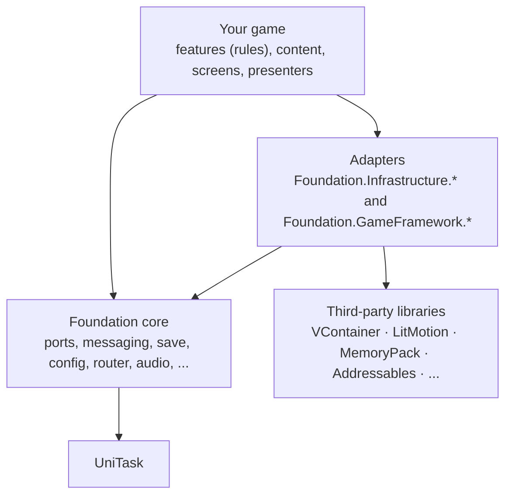
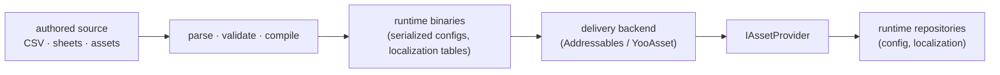

# Architecture

Foundation is a set of mechanisms. A game is rules, content and presentation built on those mechanisms. The package
keeps the boundary sharp so that a second game can reuse the first one's infrastructure without inheriting its design.

## Layers

- **Core** defines contracts (ports) and includes ready-to-use implementations where sensible defaults are possible.
  Its only mandatory third-party library is UniTask; Unity APIs remain part of the Unity-specific modules. The package
  also declares `com.unity.ugui` in its `package.json`; see [installation](../getting-started/installation) for the
  package dependencies.
- **Adapters** implement a port on top of a third-party library. Their assemblies compile when the required packages
  and compilation symbols are available; exact requirements vary by integration.
- **Your game** composes both. Gameplay rules, economy, progression and content schemas never belong in the package.

## Ports and adapters

A port is a small interface in `Foundation` (`ISerializer`, `IAssetProvider`, `IRandomService`, `IServiceRegistry`,
...). Most runtime adapter assemblies follow the `Foundation.Infrastructure.<Library>` naming pattern; mobile and some UI
integrations use other names (see [Adapters](../adapters/overview)). Unity sets some compilation symbols from package
metadata; other integrations require an additional symbol during project setup. Adapters isolate most direct runtime
references to third-party libraries from feature code. One exception is the Typed IDs generator, which emits
MemoryPack-specific formatter code when MemoryPack support is enabled.

Ports let features keep using the same interfaces when a project changes an adapter. The project still needs to configure
the new backend and its delivery pipeline. Changing serialization formats also requires rebuilding content and handling
existing saves; registering a different serializer does not convert previously written data. See
[Adapters](../adapters/overview) for the complete list, tested versions, and how to write your own.

UniTask is the exception: it appears throughout the asynchronous API rather than being hidden behind an implementation
port. If you need another task type at your own boundary, convert there (`UniTask` ⇄ `Task`/`Awaitable`).

## Features own their state

A *feature* is a self-contained piece of game logic with an `IFeatureInstaller`, its own runtime state and, if it
persists, its own save segment.

- A feature's runtime state is private to it. Another feature must not read or mutate it.
- Cross-feature interaction goes through explicit capabilities: a service interface the owning feature exposes, a
  [command](../core/messaging), a query returning a read model, or an event.
- UI reads state through queries or read models, never through runtime state.

This keeps dependencies visible: if feature A needs feature B, A's constructor says so.

## Messages have meanings

Three buses, three different contracts (see [Messaging](../core/messaging)):

| | Means | Handlers |
| --- | --- | --- |
| Command | "Do this" (mutates state) | exactly one |
| Query | "Tell me this" (reads state) | exactly one |
| Event | "This happened" (a past-tense fact) | any number |

Events never cancel a mutation, so there are no `BeforeX` events: validation belongs in the command handler. Not every
method call needs to be a command; use one where a request crosses a feature boundary or where tracing it helps.

## Simulation is independent of presentation

Anything that advances with time, like production, timers or combat, runs from the [simulation
runner](../core/simulation) or the [scheduler](../core/time-scheduling-random), not from views. UI observes state and
never drives ticking. The simulation can run without visible UI while the application process is ticking, and it is
testable without Unity objects. This does not guarantee background execution while the operating system has suspended
the application.

## Content authoring is separate from delivery

Two different pipelines are easy to confuse:

*Authoring* decides how data becomes compiled content; *delivery* decides how those files reach the device. Delivery
labels and groups do not define gameplay schemas, and validators do not contain loading logic. Keep balance and tuning
in content, not in feature code. See [Config](../app/config), [Content](../app/content) and
[Localization](../app/localization).

## Where to go from here

- [Application composition](app-composition): how the boot, root scope and game contexts fit together.
- [Quick start](../getting-started/quick-start): a working scope in a few minutes.
- [Adapters](../adapters/overview): the ports and what implements them.
