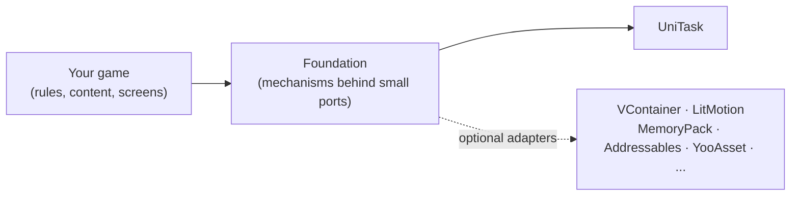

# Foundation

Foundation provides reusable startup, service scopes, persistence and presentation infrastructure for Unity 6000.5 or
newer (`com.fzfking.foundation`). Foundation includes minimal reactive value and event-stream types; a project can use
them directly or bridge another reactive library at its own boundaries. The project chooses its DI container,
serializer and tween library.

## Principles

- **Ports and adapters.** Optional third-party integrations are accessed through ports in `Foundation` and optional
  adapter assemblies. [UniTask](https://github.com/Cysharp/UniTask) is the required async dependency and appears
  directly in package APIs.
- **Game-independent infrastructure.** Economy, progression, combat rules and content schemas belong to your project.
- **Explicit feature registration.** Each feature provides an `IFeatureInstaller` that registers its services through
  `IServiceRegistry`. The composition root applies these installers without exposing a specific DI container to them.

## What is in it

| Area | What it gives you | Start here |
| --- | --- | --- |
| Composition | DI port, feature installers, entry points, boot pipeline, root scope | [Quick start](getting-started/quick-start), [Application composition](concepts/app-composition) |
| Contexts | One running game at a time, with its own scope, configs and save namespace; loadable game modules | [Game contexts](app/game-contexts) |
| Messaging | Commands, queries and events with development tracing | [Messaging](core/messaging) |
| Logic | State machine, fixed-step simulation, scheduler, requirements, rewards, feature flags | [State machine](core/state-machine), [Simulation](core/simulation) |
| Persistence | Segmented save: each feature owns its slice | [Save](app/save) |
| Data and content | Config groups, asset provider, localization | [Config](app/config), [Content](app/content), [Localization](app/localization) |
| UI | Backend-neutral layered router, uGUI components, tabs, tooltips, badges, feedbacks | [UI router](ui/router) |
| Systems | Audio, pooling, typed IDs, scripted sequences, tutorials, motion, and asynchronous object spawning with a per-frame integration-time budget | [Audio](systems/audio), [Tutorial](systems/tutorial), [Motion](core/reactive-motion), [Content](app/content) |
| Release | Client version policy and remote release configuration | [Release controller](app/release) |
| Mobile services | Ads, IAP, identity, notifications, cloud save, analytics backends | [GameFramework](gameframework/overview) |

## Games built with Foundation

- [Vampires World Idle](https://play.google.com/store/apps/details?id=com.freedominteractive.vampireWorldIdle) by Freedom Interactive Studios: a vampire idle tycoon for Android.

Made a game with Foundation? Open an issue or a pull request to add it here.

## How to read this documentation

1. [Installation](getting-started/installation) and [Quick start](getting-started/quick-start) get a scope running.
2. [Architecture](concepts/architecture) and [Application composition](concepts/app-composition) explain how the pieces
   fit and where a project plugs in.
3. The **Core**, **Application**, **UI** and **Systems** sections are independent guides; read the ones you need.
4. [Adapters](adapters/overview) lists the ports, the libraries that implement them, and how to write your own.

Examples marked `csharp compile` are intended to compile together within their page, with the required adapters
installed. Other C# blocks are fragments or demonstrate invalid usage.
