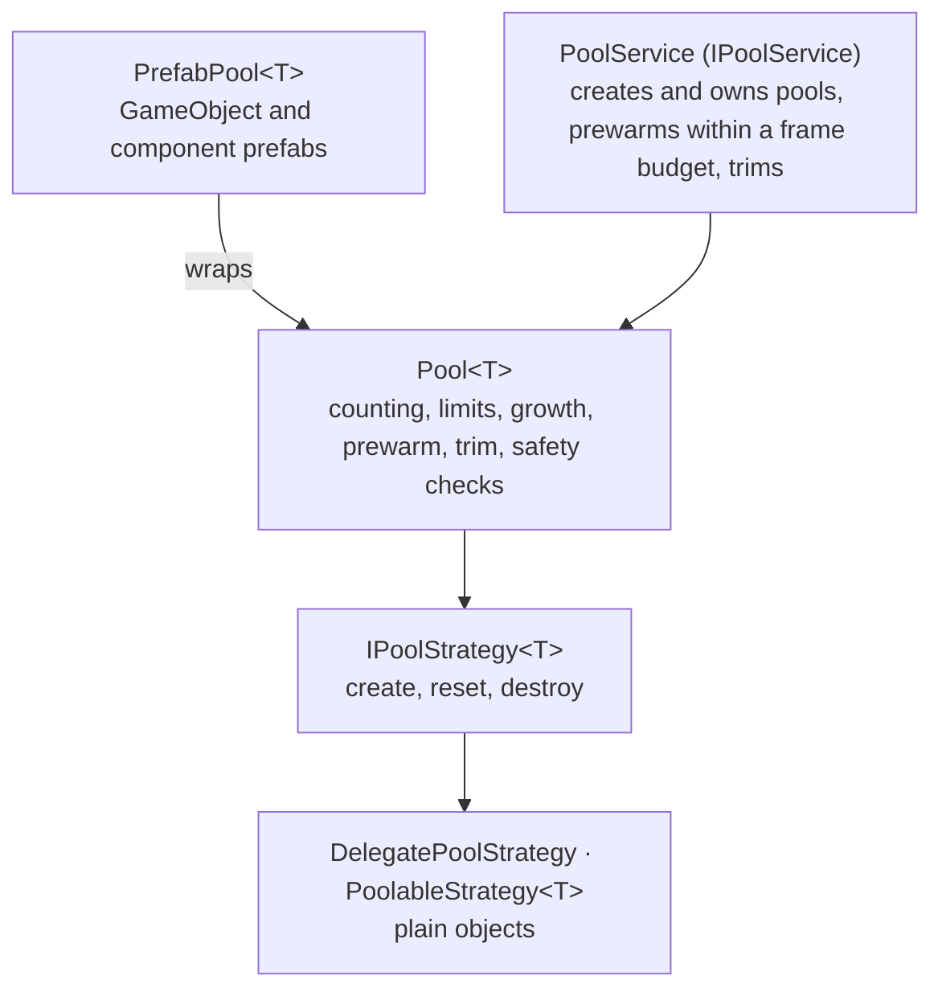

# Pooling

Generic pooling with prewarming, limits, trimming, ownership checks and statistics.



`Pool<T>` knows nothing about Unity objects: how an instance is created, activated, reset and destroyed is the
strategy's job. `T` is a class on purpose, so generic code is shared on IL2CPP and HybridCLR.

## Setup

`PoolingInstaller` registers `IPoolService`. Install it before anything that rents pooled objects (the [audio](audio)
system needs it).

```csharp compile
using System;
using System.Threading;
using Cysharp.Threading.Tasks;
using Foundation.Content;
using Foundation.DI;
using Foundation.Pooling;
using UnityEngine;

public sealed class PoolsFeature : IFeatureInstaller
{
    public void Install(IServiceRegistry registry) => new PoolingInstaller().Install(registry);
}
```

## Plain objects

A pooled class implements `IPoolable` (or you pass delegates). The pool calls the hooks; it does not reset anything
else.

```csharp compile
public sealed class Bullet : IPoolable
{
    public Vector3 Position { get; set; }

    public void OnCreated()
    {
    }

    public void OnRented()
    {
    }

    public void OnReturned() => Position = default;

    public void OnDestroying()
    {
    }
}

public sealed class BulletSpawner
{
    private readonly Pool<Bullet> _bullets = new(
        PoolId.From("bullets"),
        new PoolableStrategy<Bullet>(() => new Bullet()),
        new PoolSettings(prewarmCount: 32, maxRetained: 128));

    public void Fire(Vector3 from)
    {
        var bullet = _bullets.Rent();
        bullet.Position = from;
        _bullets.Return(bullet);
    }

    public void FireScoped(Vector3 from)
    {
        using var lease = _bullets.Lease();
        lease.Item.Position = from;
    }
}
```

`Lease()` returns the item to the pool when disposed. For a value that needs no hooks, `ObjectPool<T>` is a smaller pool
built from delegates, and `DelegatePoolStrategy<T>` does the same for `Pool<T>`.

## Prefabs

`IPoolService.CreatePrefabPool` pools a prefab that is already loaded. Instances wait under an inactive container, so
they get no `Awake`, `OnEnable` or `Update` until they are rented, and renting is a reparent.

```csharp compile
public sealed class RowView : PoolableBehaviour
{
    protected override void OnPoolReturned()
    {
        // Undo what the rental did: subscriptions, tweens, bound data.
    }
}

public sealed class RowList
{
    private readonly PrefabPool<RowView> _rows;

    public RowList(IPoolService pools, RowView rowPrefab)
        => _rows = pools.CreatePrefabPool(PoolId.From("rows"), rowPrefab);

    public RowView Add(Transform listRoot) => _rows.Rent(listRoot);

    public void Remove(RowView row) => _rows.Return(row);
}
```

`PoolableBehaviour` is a base class that forwards the four hooks to `OnPoolCreated`, `OnPoolRented`, `OnPoolReturned`
and `OnPoolDestroying`, and exposes `PoolLifetime`, a token canceled when the instance is returned. This signals
cancellation to async work started while the object is rented; the work stops only if it observes and honors the token:

```csharp compile
public sealed class PulsingRow : PoolableBehaviour
{
    protected override void OnPoolRented() => PulseAsync(PoolLifetime).Forget();

    private async UniTaskVoid PulseAsync(CancellationToken cancellationToken)
    {
        while (!cancellationToken.IsCancellationRequested)
        {
            transform.localScale = Vector3.one * (1f + 0.05f * Mathf.Sin(Time.time * 4f));
            await UniTask.Yield(cancellationToken).SuppressCancellationThrow();
        }
    }
}
```

### Prefabs loaded through the asset provider

When the prefab must be loaded, hand the pool an `IPrefabSource`. The pool owns the loaded asset and releases it after
it destroys its instances, which is when the provider may unload it. `AssetProviderPrefabSource` loads through an
[`IAssetProvider`](../app/content); `DirectPrefabSource` wraps a reference you already hold.

```csharp compile
public sealed class EnemyView : PoolableBehaviour
{
}

public sealed class EnemyPools
{
    private readonly IPoolService _pools;
    private readonly IAssetProvider _assets;

    public EnemyPools(IPoolService pools, IAssetProvider assets)
    {
        _pools = pools;
        _assets = assets;
    }

    public UniTask<PrefabPool<EnemyView>> CreateAsync(CancellationToken cancellationToken)
        => _pools.CreatePrefabPoolAsync<EnemyView>(
            PoolId.From("enemy"),
            new AssetProviderPrefabSource(_assets, "enemies/zombie"),
            new PoolSettings(prewarmCount: 20, maxRetained: 40),
            cancellationToken);
}
```

Prefab instances are injected through the scope's [`IGameObjectInjector`](../core/di#injecting-monobehaviours) once, at
creation.

## Settings

`PoolSettings` (serializable, so it can sit in an inspector):

| Setting | Meaning |
| --- | --- |
| `PrewarmCount` | Idle instances that a prewarm call aims for. A pool never prewarms on its own. |
| `MinRetained` / `MaxRetained` | Idle instances kept. A return beyond `MaxRetained` destroys the instance (0 means unlimited). |
| `MaxActive` / `ExhaustedBehavior` | Cap on rented instances; at the cap a rent returns null (`ReturnNull`) or throws (`Throw`). |
| `GrowthBatch` | Instances created when a rent finds the pool empty: one for the caller, the rest idle. |
| `IdleTrimSeconds` / `TrimBatchSize` | Destroy instances idle longer than this, down to `MinRetained`, at most this many per check. |

`Validate()` lists problems. The constructor rejects the hard errors; "prewarm exceeds max retained" is only a warning.

## Prewarming

```csharp compile
public sealed class LoadingScreenPrewarm
{
    private readonly IPoolService _pools;

    public LoadingScreenPrewarm(IPoolService pools) => _pools = pools;

    public UniTask RunAsync(IProgress<float> progress, CancellationToken cancellationToken)
        => _pools.PrewarmAllAsync(budgetMillisecondsPerFrame: 1.0, progress, cancellationToken);
}
```

Budgeted prewarm creates instances until the frame's budget is spent (always at least one per frame), then yields.
`Prewarm(target)` is synchronous and can cause a frame spike. `Pool<T>.PrewarmAsync(target, instancesPerFrame)`
spreads a fixed count across frames; `PrefabPool<T>` and `IPool<T>` expose the time-budgeted overload instead.
Call `PrewarmAllAsync` while a loading screen is up.

## One view per entity

`KeyedViewSet<TKey, TView>` keeps one pooled view per id. A frame brackets its reads with `BeginSync`/`EndSync`: an
acquired id keeps its view or rents one while the pool can supply it; every other view returns to the pool. Once the
backing collections have enough capacity for the peak number of active ids, synchronizing within that capacity does
not allocate.

```csharp compile
public sealed class EnemyViewSync
{
    private readonly KeyedViewSet<int, EnemyView> _views;

    public EnemyViewSync(IPool<EnemyView> pool) => _views = new KeyedViewSet<int, EnemyView>(pool);

    public void Sync(ReadOnlySpan<int> aliveEnemyIds)
    {
        _views.BeginSync();

        foreach (var id in aliveEnemyIds)
        {
            var view = _views.Acquire(id, out var created);
            if (created && view != null)
                view.transform.localPosition = Vector3.zero;
        }

        _views.EndSync();
    }
}
```

Use `EndSync(List<TView> retired)` instead when vanished views should play a leaving animation first; hand them back
with `Recycle` afterwards.

## Diagnostics and safety

`PoolStats` reports `Created`, `Active`, `Inactive`, `PeakActive`, `RentCount`, `ReturnCount`, `Misses` (a rent found no
idle instance), `Expansions`, `Rejected` (`MaxActive`), `Destroyed` and `SuggestedPrewarm` (the observed peak: data, not
auto-tuning). `IPoolService.Collect(List<IPool>)` lists the pools a service owns; `PoolRegistry.Collect(List<IPool>)`
lists every live pool in the Editor and development builds and does nothing in other builds.

Every build tracks rented instances by reference, so a **double return** or **return to the wrong pool** is rejected before
it can corrupt the idle list. A rent or `Adopt` after disposal is reported in every build. Safety checks run in the Editor and
development builds (`PoolDefaults.SafetyChecks`) add owner details and detect **leaks at disposal**. A reported violation goes to an
`IPoolViolationHandler` (`LoggingPoolViolationHandler` by default; set `PoolDefaults.ViolationHandler` to
`ThrowingPoolViolationHandler.Instance` in tests) and is ignored, so the pool stays consistent.

## Ownership

- The pool owns its instances; a caller owns a rented instance until it returns it.
- `PoolService` owns the pools it creates (`Release(id)` disposes one) and a `DontDestroyOnLoad` root, so pools survive
  scene loads. An instance parented into a scene that is then unloaded is detected and dropped instead of reused.
- Disposing a pool with rented instances reports `LeakedOnDispose` in development builds; instances returned later are
  destroyed.

## HybridCLR and IL2CPP

`PoolAotHints` instantiates the generic pools over reference types so their shared code exists in the AOT assembly. Keep
`Foundation.Pooling` in `link.xml`.
