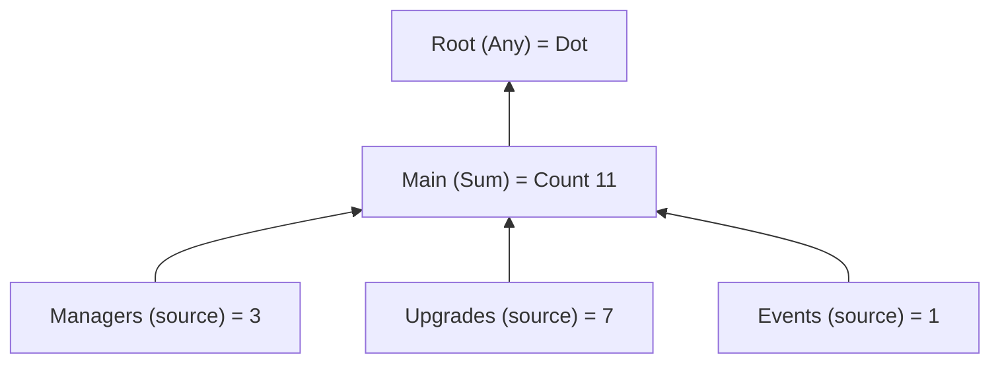

# Badges

`Foundation.Badges` is a reusable, event-driven notification-badge graph. Gameplay owns the badge **rules** through
`IBadgeSource`; the UI consumes `IBadgeService` and never queries a game feature to decide whether a badge is visible.



| Type | Role |
| --- | --- |
| `BadgeId` | A [typed id](../systems/typed-ids). |
| `BadgeDefinition` | A node: id, optional parent, `BadgeAggregation` (`None`, `Any`, `Sum`, `Max`). |
| `BadgeCatalog` | A ScriptableObject holding the definitions (**Create → Foundation → Badges → Catalog**). |
| `IBadgeSource` | Supplied by a feature: `Id`, `Value`, and a `Changed` event. |
| `IAcknowledgeableBadgeSource` | A source with one-time "New" content: `Acknowledge()`. |
| `IBadgeService` | `Get(id)`, `Observe(id)`, `RegisterSource`, `UnregisterSource`, `Acknowledge(id)`. |
| `BadgeValue` | `None`, `Dot`, `Count(n)` or `New`. |

## Wiring

Install the service with a catalog, then register each source when its feature becomes ready.

```csharp compile
using System;
using Foundation.Badges;
using Foundation.DI;
using Foundation.Reactive;

public sealed class ManagersBadgeSource : IBadgeSource, IDisposable
{
    private readonly Func<int> _availableManagers;

    public ManagersBadgeSource(Func<int> availableManagers) => _availableManagers = availableManagers;

    public BadgeId Id => BadgeId.From("managers");

    // Computed from the feature's own authoritative state.
    public BadgeValue Value => BadgeValue.FromCount(_availableManagers());

    public event Action Changed;

    // Raise it only when the underlying state may have changed. There is no polling.
    public void NotifyChanged() => Changed?.Invoke();

    public void Dispose() => Changed = null;
}

public static class BadgeCatalogExample
{
    public static BadgeCatalog Create() => BadgeCatalog.Create(new[]
    {
        new BadgeDefinition(BadgeId.From("root"), aggregation: BadgeAggregation.Any),
        new BadgeDefinition(BadgeId.From("main"), BadgeId.From("root"), BadgeAggregation.Sum),
        new BadgeDefinition(BadgeId.From("managers"), BadgeId.From("main")),
    });
}

public sealed class ManagersFeature : IDisposable
{
    private readonly IBadgeService _badges;
    private readonly ManagersBadgeSource _source;
    private int _available = 3;

    public ManagersFeature(IBadgeService badges)
    {
        _badges = badges;
        _source = new ManagersBadgeSource(() => _available);
        _badges.RegisterSource(_source);
    }

    public void OnManagerBecameAvailable()
    {
        _available++;
        _source.NotifyChanged();
    }

    public void Dispose() => _badges.UnregisterSource(_source);
}

public sealed class BadgeIcon : IDisposable
{
    private readonly IDisposable _subscription;

    public BadgeIcon(IBadgeService badges)
    {
        // Delivers the current value at once, then every change.
        _subscription = badges.Observe(BadgeId.From("managers")).Subscribe(Render);
    }

    public void Dispose() => _subscription.Dispose();

    private void Render(BadgeValue value)
    {
        // Show nothing, a dot, a number or "New" according to value.Kind.
    }
}
```

`new BadgeInstaller(catalog)` in the feature installer list registers the catalog and `BadgeService` as `IBadgeService`.

## Rules

- **One source owns a badge id.** Duplicate sources and duplicate definitions are rejected, and unknown ids throw, so broken
  content is visible during development.
- **The graph is a forest.** Each definition has at most one parent; missing parents and cycles are rejected.
- **Aggregation.** `Any` produces `Dot` when anything is active, `Sum` adds counts, `Max` takes the greatest count, `None` uses
  only the node's own source. A `Dot` or `New` contributes one to a numeric aggregate. Counts saturate at `int.MaxValue`;
  `FromCount(0)` and negative counts become `None`.
- **Updates walk only the changed path.** A change recomputes the changed node and walks its ancestors until the value stops
  changing. Independent branches are untouched.
- **Acknowledging.** For one-time `New` content, implement `IAcknowledgeableBadgeSource` and call `Acknowledge(id)`. The source
  owns the acknowledged state and persists it through your [save](../app/save). The badge core creates no file, uses no
  `PlayerPrefs` and does not infer when content was read.

## Presentation

The package ships no badge view. The dot, count or "New" visuals, their text renderer and the localized "New" label belong to
your presentation layer. A view subscribes on enable and disposes the subscription on disable.
