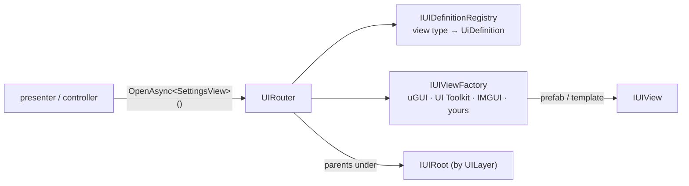

# UI router

`IUIRouter` opens, closes and replaces views by definition. It is independent of a UI technology: it asks an
`IUIViewFactory` to create a view from a `UiDefinition`, then drives the view's `ShowAsync` and `HideAsync`. Each router
is an independent navigation scope with its own stack, cache and root.



| Type | Role |
| --- | --- |
| `IUIView` | A view's lifecycle: `ShowAsync` and `HideAsync` (play your animation inside them). |
| `UiDefinition` | How to build a view: view id, an `IUIViewSource` (where it comes from), `UILayer`, `UICachePolicy`, `BlockInput`, `AllowBack`, `AllowDuplicates`. |
| `IUIDefinitionRegistry` | Maps a view type to its definition, so `OpenAsync<TView>()` needs no definition at the call site. |
| `UILayer` | `FullScreen`, `Overlay`, `Popup`. Decides which root a view is parented under. |
| `UICachePolicy` | `DestroyOnClose`, or `KeepAlive` (the instance is hidden and reused on the next open). |
| `UiArgs` | A dictionary of arguments passed on open. A view that implements `IUIArgsReceiver` gets them in `SetArgs`. |
| `IUIBackHandler` | A view that wants to handle the Back key itself. |
| `IUIViewFactory` | The backend: creates the view and an `IUIViewInstance` that knows how to dispose it. |
| `IUIRoot` | Where instances are parented, per layer. `TransformUIRoot` (screen and popup roots) and `LayerUIRoot` (one explicit layer). |

## Defining and opening views

```csharp compile
using System.Threading;
using Cysharp.Threading.Tasks;
using Foundation.Content;
using Foundation.DI;
using Foundation.UI;
using Foundation.UI.UGui;
using UnityEngine;

public sealed class SettingsView : MonoBehaviour, IUIView, IUIArgsReceiver
{
    public string Section { get; private set; } = "general";

    public void SetArgs(UiArgs args)
    {
        if (args.TryGetValue<string>("section", out var section))
            Section = section;
    }

    public UniTask ShowAsync(CancellationToken cancellationToken = default)
    {
        gameObject.SetActive(true);
        return UniTask.CompletedTask;
    }

    public UniTask HideAsync(CancellationToken cancellationToken = default)
    {
        gameObject.SetActive(false);
        return UniTask.CompletedTask;
    }
}

public sealed class HomeView : MonoBehaviour, IUIView
{
    public UniTask ShowAsync(CancellationToken cancellationToken = default)
    {
        gameObject.SetActive(true);
        return UniTask.CompletedTask;
    }

    public UniTask HideAsync(CancellationToken cancellationToken = default)
    {
        gameObject.SetActive(false);
        return UniTask.CompletedTask;
    }
}

// Scene references (the roots) are passed in by the composition root, which owns the scene.
public sealed class UiInstaller : IFeatureInstaller
{
    private readonly Transform _screenRoot;
    private readonly Transform _popupRoot;

    public UiInstaller(Transform screenRoot, Transform popupRoot)
    {
        _screenRoot = screenRoot;
        _popupRoot = popupRoot;
    }

    public void Install(IServiceRegistry registry)
    {
        var definitions = new UIDefinitionRegistry();
        definitions.Register<HomeView>(new UiDefinition(
            "home", new AddressViewSource("ui/home"), UILayer.FullScreen, UICachePolicy.KeepAlive, blockInput: false, allowBack: false));
        definitions.Register<SettingsView>(new UiDefinition(
            "settings", new AddressViewSource("ui/settings"), UILayer.Popup, UICachePolicy.DestroyOnClose, blockInput: true, allowBack: true));

        registry.RegisterInstance<IUIDefinitionRegistry>(definitions);
        registry.Register<UIRouterFactory>(ServiceLifetime.Singleton).As<IUIRouterFactory>();
        registry.Register(
            resolver => resolver.Resolve<IUIRouterFactory>().Create(new TransformUIRoot(_screenRoot, _popupRoot)),
            ServiceLifetime.Singleton);
    }
}

public sealed class NavigationExample
{
    private readonly IUIRouter _router;

    public NavigationExample(IUIRouter router) => _router = router;

    public async UniTask RunAsync()
    {
        await _router.ReplaceAsync<HomeView>();

        var args = new UiArgs(new System.Collections.Generic.Dictionary<string, object> { ["section"] = "audio" });
        var settings = await _router.OpenAsync<SettingsView>(args);

        await _router.CloseAsync(settings);
    }
}
```

The `UIRouterFactory` creates routers over a shared definition registry, asset provider, injector and spawner. Call
`Create(root)` again to get **a second router** with its own stack and root, for example a router that renders only into
one container. `LayerUIRoot` restricts a router to one layer and throws if a view from another layer is opened.

## Behavior to know

`KeepAlive` and `AllowDuplicates` cannot be combined: a definition rejects that combination. Duplicate windows use
`DestroyOnClose`. An open or close is committed once the view's `ShowAsync` or `HideAsync` returns successfully, even if
the caller token was canceled meanwhile. From that point only `Dispose` can still undo the commit. If the view's
callback throws or is canceled before returning, the operation does not commit: a failed hide keeps the window owned and
tracked, and close can be retried. A late factory result is disposed without being shown.

- **`OpenAsync`** pushes onto the stack and shows the view. Opening a definition that is already open (and does not
  allow duplicates) re-applies the arguments and shows the existing view instead of making a second one. A successful
  show commits the open on both paths, so a cancellation that arrives after it does not turn the call into a failure.
- **`ReplaceAsync`** shows the target before hiding the other open views, then moves the target to the top of the stack.
  The transition can briefly show both. If the target's show fails or is canceled before returning successfully, the
  other views stay open. A successful show commits the target: cancellation after that point stops the remaining hides
  but leaves the target open, so the call can report cancellation with the target already in place. Each outgoing hide
  is a separate step, so some may have completed when the operation stops while the rest remain open and can be closed
  later. With no outgoing views left to hide, cancellation after the target show does not cancel the call.
- **`CloseAsync(view)`** hides the view and, for `DestroyOnClose`, disposes it. A successful hide commits the close even
  if the caller token is canceled by then. If `HideAsync` fails or is canceled, the view stays in the stack and close can
  be retried.
- **`ClearAsync()`** closes views from the top of the stack one at a time. Each successful hide removes that view, so a
  failure or cancellation partway through leaves the views already hidden closed and the rest open. Partial results are
  possible.
- **`BackAsync()`** asks the top view to handle Back if it implements `IUIBackHandler`, regardless of `AllowBack`.
  Otherwise it closes the view only when its definition has `AllowBack`. It returns `false` when there is nothing to do,
  so a platform can fall through to its default (see `AndroidBackButton` below). A Back-triggered close follows the
  same rule: a successful hide commits it.
- **`Dispose()`** tears down the router rather than navigating: it cancels operations, clears the stack and cache, and
  releases tracked instances after in-flight `ShowAsync`, `HideAsync`, and Back handlers return. The router is unusable
  afterwards.
- **Operations are serialized** by an internal gate; a view's `HandleBackAsync` runs outside it, so a handler may open
  or close views itself. The corollary: a view must not await a router operation from inside its own `ShowAsync` or
  `HideAsync`, because that operation would wait for the gate the view's operation still holds. Start it without
  awaiting, or after the view has finished showing.
- **`HasOpenViews(layer)`** tells whether a layer has anything open.
- `BlockInput` is data on the definition for your presentation layer (for example an input-blocking backdrop). The
  router itself does not interpret it.
- Views are injected with the scope's `IGameObjectInjector` **before** they are shown, so a `MonoBehaviour` implementing
  `IServiceResolverClient` receives its services ([DI](../core/di#injecting-monobehaviours)).

## Popups

Popups are ordinary views on `UILayer.Popup`. `PopupDefinitions.FromAddress(viewId, address)` and `FromPrefab(viewId,
prefab)` give the usual definition: destroyed on close, blocks input, closed by Back, never merged with another open
popup. `router.OpenPopupAsync<TView>(definition, args)` opens one and returns a `PopupHandle<TView>`:

```csharp compile
public sealed class ConfirmPopup : MonoBehaviour, IUIView
{
    public UniTask ShowAsync(CancellationToken cancellationToken = default)
    {
        gameObject.SetActive(true);
        return UniTask.CompletedTask;
    }

    public UniTask HideAsync(CancellationToken cancellationToken = default)
    {
        gameObject.SetActive(false);
        return UniTask.CompletedTask;
    }
}

public sealed class PopupExample
{
    private static readonly UiDefinition Confirm = PopupDefinitions.FromAddress("confirm", "ui/confirm");

    private readonly IUIRouter _router;

    public PopupExample(IUIRouter router) => _router = router;

    public async UniTask AskAsync(CancellationToken cancellationToken)
    {
        using var popup = await _router.OpenPopupAsync<ConfirmPopup>(Confirm, cancellationToken: cancellationToken);

        // popup.View is the ConfirmPopup. Dispose closes it without waiting; CloseAsync() waits.
        await UniTask.Delay(1000, cancellationToken: cancellationToken);
        await popup.CloseAsync();
    }
}
```

## Android Back

`AndroidBackButton` (assembly `Foundation.UI.InputSystem`, present when the Input System package is) sends the Escape or
Android Back key to `IUIRouter.BackAsync` of the scope it is registered in. With nothing open, the press is left to the
platform. Register it with `registry.RegisterEntryPoint<AndroidBackButton>()`.

## Tabs

`ITabGroup` and `ITabSwitchHandler` are the contracts for a selection control and for what a selection triggers.
`UITabGroup` (uGUI) starts every registered handler with a `TabSwitch` (previous tab, new tab, direction, and the
buttons' selection animation as a `UniTask`) and settles when all of them complete. A handler can be authored next to
the group (`switchHandlers`) or added from code with `AddSwitchHandler`. The group itself knows nothing about content,
loaders, layouts or what locks a tab.

`ITabGroupTrySelect` is the companion contract for a group that reports a selection it could not start.
`UITabGroup.TrySelectAsync` returns `false` at once while another selection is still transitioning and does not queue
the request. `SelectAsync` keeps its older behavior in that situation: it returns without selecting and without saying
so. When the group is idle, asking for the tab that is already selected returns `true` and starts no transition, so no
event fires.

```csharp compile
public sealed class ShopView : MonoBehaviour, IUIView
{
    public UniTask ShowAsync(CancellationToken cancellationToken = default)
    {
        gameObject.SetActive(true);
        return UniTask.CompletedTask;
    }

    public UniTask HideAsync(CancellationToken cancellationToken = default)
    {
        gameObject.SetActive(false);
        return UniTask.CompletedTask;
    }
}

public sealed class ContentTabHandler : ITabSwitchHandler
{
    private readonly IUIRouter _router;

    public ContentTabHandler(IUIRouter router) => _router = router;

    public async UniTask HandleAsync(TabSwitch tabSwitch, CancellationToken cancellationToken)
    {
        if (tabSwitch.TabId == "shop")
            await _router.ReplaceAsync<ShopView>(cancellationToken: cancellationToken);
        else
            await _router.ReplaceAsync<HomeView>(cancellationToken: cancellationToken);

        await tabSwitch.SelectionVisuals;
    }
}

public sealed class TabsBootstrap
{
    public static async UniTask StartAsync(UITabGroup tabs, IUIRouter router, CancellationToken cancellationToken)
    {
        tabs.AddSwitchHandler(new ContentTabHandler(router));
        await tabs.SelectInitialAsync(cancellationToken);
    }
}
```

`SelectedTabChanged` fires as the switch starts; `SelectedTabSettled` fires after every handler and the button
animation has completed. By then the selection is committed: an exception thrown by a `SelectedTabSettled` subscriber
reaches the caller and leaves the selected tab and the content the handlers switched in place. A selection attempted
from inside either event happens while the transition that raised it is still running, so `TrySelectAsync` returns
`false` there and `SelectAsync` drops the request.

`UITabItem` shows the button state named by its state ids, with an optional game-supplied override state and a click
block.

## Backends

`UIRouter` does not know a UI technology. The definition's `Source` (an `IUIViewSource`) says where the view comes from;
the backend's factory builds the sources it knows and rejects the rest.

| Backend | Assembly | Define | Sources |
| --- | --- | --- | --- |
| uGUI | `Foundation.UI.UGui` | none | `PrefabViewSource` (a prefab reference) or `AddressViewSource` (loaded through `IAssetProvider`) |
| UI Toolkit | `Foundation.UI.Toolkit` | `FOUNDATION_UITOOLKIT` | `UiToolkitTemplate` (UXML or a code-built tree) |
| IMGUI | `Foundation.UI.Imgui` | `FOUNDATION_IMGUI` | `ImguiTemplate`, drawn by an `ImguiHost` |

```csharp
public sealed class ToolkitSettingsView : UiToolkitView { }

// UI Toolkit: views are element trees under a root container.
registry.RegisterInstance<IUIViewFactory>(new UiToolkitViewFactory(new UiToolkitRoot(screens, popups)));
var source = new UiToolkitTemplate(tree, () => new ToolkitSettingsView());   // VisualTreeAsset or Func<VisualElement>
var definition = new UiDefinition("settings", source, UILayer.Popup, UICachePolicy.DestroyOnClose, blockInput: true, allowBack: true);
```

To use another UI library, implement `IUIViewFactory` and `IUIView` for it and register the factory. The router, back
stack, caching and arguments keep working unchanged. Separate routers (and scopes) can use different backends.

## Tooltips

`TooltipPlacement.Compute` is pure, allocation-free rect math. Given a target rect, the tooltip size, the bounds, a gap
and an arrow margin, it returns a `TooltipLayout` (center, side, arrow offset, whether it fits): the preferred side if
it fits, else above or below by room, else left or right, clamped to the bounds.

The math is independent of the UI library, but it assumes **y grows upward** (uGUI's convention): "above" is the side
with larger y. UI Toolkit and IMGUI measure y downward, so mirror the rects on the way in and the center on the way out;
the sides then keep their visual meaning.

```csharp compile
using Foundation.UI;
using UnityEngine;

public static class ToolkitTooltipPlacement
{
    public static TooltipLayout Compute(Rect target, Vector2 size, Rect bounds, TooltipSide preferred = TooltipSide.Auto)
    {
        var layout = TooltipPlacement.Compute(Flip(target), size, Flip(bounds), gap: 8f, arrowMargin: 12f, preferred);
        return new TooltipLayout(
            new Vector2(layout.Center.x, -layout.Center.y),
            layout.Side,
            layout.Side == TooltipSide.Left || layout.Side == TooltipSide.Right ? -layout.ArrowOffset : layout.ArrowOffset,
            layout.Fits);
    }

    private static Rect Flip(Rect rect) => new(rect.x, -rect.yMax, rect.width, rect.height);
}
```

`TooltipBubble` (uGUI) applies it to a box: `SetAnchor(target, side, showArrow)` stands the box next to a target and
points an arrow at it; `SetAvoid` keeps it clear of a second area; the owner calls `Place(space, deltaTime)` once per
frame, after layout, to glide to a new placement, follow a moving target and stay inside the safe area. When the box's
text changes size, call `Remeasure()` after the layout rebuild. For a button hint, the view owns its `TooltipBubble`;
Foundation provides no tooltip service.
