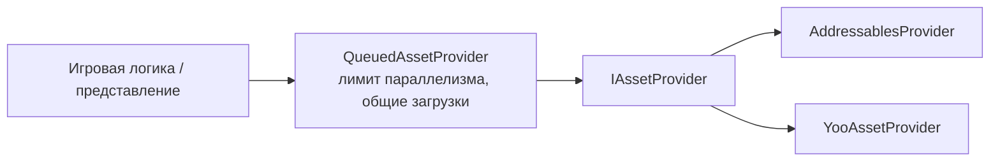

# Контент и ассеты

`IAssetProvider` — единственный интерфейс, через который игровой код загружает ресурсы, создаёт экземпляры
префабов и освобождает их. `Foundation` не зависит от Addressables или YooAsset: для них предусмотрены отдельные
[адаптеры](../adapters/addressables) и [YooAsset](../adapters/yooasset).

Маршрутизация удалённого контента через несколько источников описана в разделе [Зеркала контента](content-mirroring).



## IAssetProvider {#iassetprovider}

```csharp
UniTask<IAssetHandle<T>> LoadAssetAsync<T>(string assetId, CancellationToken ct = default) where T : UnityEngine.Object;
UniTask<IAssetInstance> InstantiateAsync(string assetId, Transform parent = null, CancellationToken ct = default);
bool ContainsAsset<T>(string assetId) where T : UnityEngine.Object;
UniTask<IPreloadHandle> PreloadAsync(IReadOnlyList<string> assetIds, IProgress<float> progress = null, CancellationToken ct = default);
```

Адрес ресурса задаётся строкой. Загрузка возвращает дескриптор, который удерживает ссылку на ресурс. Вызовите
**`Dispose()`**, когда ресурс больше не нужен. Объединение одновременных запросов одного ресурса зависит от провайдера.

| Тип | Роль |
| --- | --- |
| `IAssetHandle<T>` | Дескриптор загруженного ресурса. `Dispose()` освобождает его. |
| `IAssetInstance` | Созданный экземпляр префаба. Уничтожение освобождает экземпляр. |
| `IPreloadHandle` | Удерживает ресурсы загруженными до вызова `Dispose()`; подходит для предзагрузки на экране загрузки. |
| `AssetHandleScope` | Хранит дескрипторы, загруженные экраном или презентером через `LoadAsync<T>` и `LoadComponentAsync<T>`. При вызове `Dispose` освобождает их все. |
| `QueuedAssetProvider` | Ограничивает число одновременных загрузок и разделяет их на две очереди: для запросов интерфейса и фоновой загрузки. Одновременные запросы одного адреса и типа используют одну загрузку. `InstantiateAsync` передаётся внутреннему провайдеру без очереди. |
| `CompositeProgress` | Объединяет несколько источников `IProgress<float>` в одно взвешенное значение 0..1 для полосы прогресса. |

```csharp compile
using System;
using System.Collections.Generic;
using System.Threading;
using Cysharp.Threading.Tasks;
using Foundation.Content;
using UnityEngine;

public sealed class LoadingScreenPresenter
{
    private readonly IAssetProvider _assets;

    public LoadingScreenPresenter(IAssetProvider assets) => _assets = assets;

    public async UniTask<IPreloadHandle> PrefetchAsync(IProgress<float> progress, CancellationToken cancellationToken)
    {
        return await _assets.PreloadAsync(new[] { "enemy-ship", "explosion-vfx" }, progress, cancellationToken);
    }
}
```

Если освободить дескриптор слишком рано, ресурс исчезнет, хотя экран ещё его показывает. Храните дескриптор
столько же, сколько живёт использующий его экран. Для этого предназначен `AssetHandleScope`:

```csharp compile
public sealed class ShopScreen : IDisposable
{
    private readonly AssetHandleScope _assets;

    public ShopScreen(IAssetProvider provider) => _assets = new AssetHandleScope(provider);

    public async UniTask ShowAsync(UnityEngine.UI.Image icon, CancellationToken cancellationToken)
    {
        icon.sprite = await _assets.LoadAsync<Sprite>("icons/gold", cancellationToken);
    }

    // При закрытии экрана освобождаются все загруженные им ресурсы.
    public void Dispose() => _assets.Dispose();
}
```

## Правила времени жизни {#lifetime-rules}

- **У каждого дескриптора есть владелец.** Обычно это экран или другой объект, который использует ресурс.
  Когда он перестаёт быть нужен, владелец освобождает дескриптор.
- **Не освобождайте ресурсы из игровых подсистем.** Временем жизни ресурсов управляет инфраструктура UI и
  провайдер. Игровые подсистемы запрашивают ресурс и передают дескриптор тому, кто его использует.
- **Запросы могут использовать общую загрузку.** `QueuedAssetProvider` объединяет запросы одного адреса и типа,
  пока существует хотя бы один дескриптор. Внутренний провайдер также может применять собственную политику кэширования.
- **Общая загрузка — по адресу и типу.** Запросы одного адреса делят загрузку, только если просят один и тот же тип.
  Тот же адрес, запрошенный другим типом (например, `Sprite`, вырезанный из листа `Texture2D`), загружается отдельно.
  `PreloadAsync` загружает как `UnityEngine.Object`, поэтому последующий типизированный запрос того же адреса берёт
  собственный дескриптор; чтобы разделить загрузку, предзагружайте через `PreloadInBackgroundAsync<T>` с типом, который
  игра запросит позже.
- **Используйте очередь.** Зарегистрируйте `QueuedAssetProvider` как основной `IAssetProvider`, чтобы он ограничивал
  количество одновременных загрузок ресурсов; `InstantiateAsync` проходит мимо очереди. `PreloadInBackgroundAsync<T>` предварительно загружает ресурс в фоне; укажите
  тот же тип, который будет запрошен при обычной загрузке.

## Главный поток {#main-thread}

Вызывайте методы `IAssetProvider` и освобождайте полученные дескрипторы в главном потоке Unity. Интерфейс не
гарантирует потокобезопасность, и провайдер не обязан выдерживать одновременные вызовы. `QueuedAssetProvider`
показывает почему: его очереди ограничивают число одновременных загрузок, а не поток, из которого их вызывают; его
собственные структуры для общих загрузок не синхронизированы.

Дескриптор владеет одной ссылкой. `LoadAssetAsync` возвращает его; освободите дескриптор, когда владелец перестанет
использовать ресурс. Провайдер освобождает нижележащую загрузку после последней ссылки. `Dispose()` провайдера
освобождает зарегистрированные им загрузки, даже если дескрипторы ещё живы. После этого вызов `Dispose()` у таких
дескрипторов ничего не освобождает.

`InstantiateAsync` подчиняется тому же правилу. `Dispose()` у `IAssetInstance` уничтожает его `GameObject` и
освобождает ссылку на префаб; если уничтожить `GameObject` раньше, ссылка освобождается тоже. `Dispose()` у
`IPreloadHandle` освобождает все ресурсы, загруженные предзагрузкой. Если предзагрузка завершилась ошибкой, провайдер
освобождает уже полученные дескрипторы и пробрасывает исключение.

## Регистрация {#registering}

Зарегистрируйте реализацию `IAssetProvider` и `IObjectSpawner`. `IObjectSpawner` — контракт для создания объектов;
`AsyncObjectSpawner` может задавать бюджет интеграции Unity, если он передан при создании. В этом примере бюджет
указан явно:

```csharp compile
using Foundation.DI;
using Foundation.Infrastructure.Addressables;
using Foundation.Logging;
using Foundation.Spawning;

public sealed class ContentInstaller : IFeatureInstaller
{
    public void Install(IServiceRegistry registry)
    {
        registry.Register<IObjectSpawner>(_ => new AsyncObjectSpawner(AsyncObjectSpawner.DefaultIntegrationTimeMS), ServiceLifetime.Singleton);
        registry.Register<IAssetProvider>(
            resolver => new QueuedAssetProvider(
                new AddressablesProvider(resolver.Resolve<Foundation.Logging.IAppLogger>(), resolver.Resolve<IObjectSpawner>())),
            ServiceLifetime.Singleton);
    }
}
```

Остальной код зависит только от `IAssetProvider`. Число параллельных загрузок задают параметры конструктора
`interactiveConcurrency` и `backgroundConcurrency`.

## Доставка контента отделена от создания {#content-delivery-is-separate-from-authoring}

Метки и группы Addressables описывают **доставку**. Они не определяют игровые схемы или правила создания.
Обычно данные проходят такой путь: исходные ресурсы → проверка → подготовленные данные ([Конфигурации](config)) →
доставка через `IAssetProvider` → загрузка в репозитории приложения. Валидаторы и инструменты сборки не должны
содержать игровую логику загрузки.
