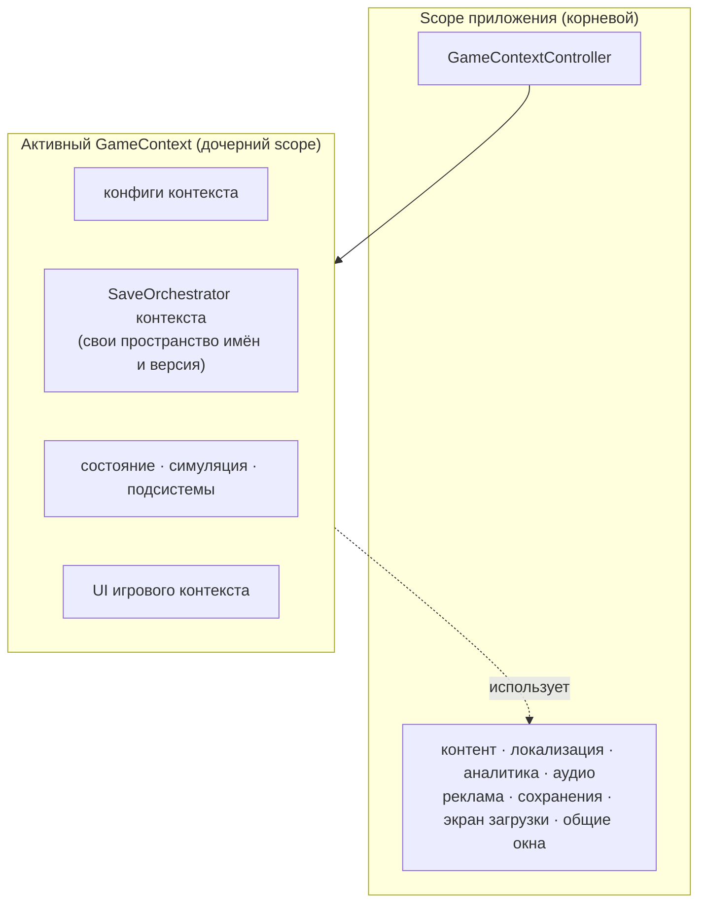
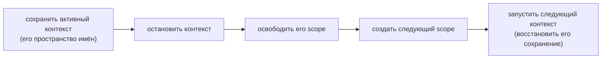

# Игровые контексты

**Игровой контекст** — изолированный игровой режим внутри приложения: основная игра, сезонное событие или
отдельный режим. Одновременно активен только один контекст. Он владеет состоянием игры, симуляцией, подсистемами,
обучением, интерфейсом, конфигурациями и пространством имён сохранений, но использует общие сервисы приложения,
не управляя их временем жизни.



Сезонное событие — это не экран и не набор флагов поверх основной игры, а отдельный режим со своей экономикой,
прогрессом и сохранением. Если представить его флагами в одной области DI-контейнера, сервисы разных режимов
окажутся вместе, как и сегменты сохранения нескольких игр.

## Составные части {#the-pieces}

| Тип | Роль |
| --- | --- |
| `GameContextId` | Идентичность контекста. По нему каталог находит определение, и он же сохраняется как последний активный контекст, поэтому переименование теряет этот выбор; слот сохранения задаётся отдельно в `GameContextSaveProfile`. |
| `GameContextDefinition` | Идентификатор контекста, его `GameContextSaveProfile` и список `IFeatureInstaller` для создания области DI-контейнера. Новый контекст задаётся новым определением, без отдельных классов жизненного цикла. |
| `GameContextSaveProfile` | Пространство имён сохранений, слот, а также собственные версия и миграции контекста. `Legacy(...)` привязывает слот к `SaveSlot.Default`. |
| `IGameContextCatalog` | Какие контексты может запускать эта сборка и запасной контекст (обычно основная игра). |
| `IGameContextRuntime` | Контракт, который контекст регистрирует в своей области DI-контейнера. `StartAsync` подготавливает контекст к игре, а `StopAsync` останавливает его. |
| `IGameContextScopeFactory` | Создаёт область DI-контейнера для контекста. `VContainerGameContextScopeFactory` — реализация для VContainer. |
| `IGameContextController` | Жизненный цикл: `EnterAsync`, `EnterStartupContextAsync`, `ReloadActiveAsync`, `ResetActiveAsync`, `ExitActiveAsync`. |
| `IGameContextSelectionStore` | Запоминает последний активный контекст вне любого пространства имён сохранений и читается до появления любого контекста. |

## Минимальный контекст {#a-minimal-context}

```csharp compile
using System.Collections.Generic;
using System.Threading;
using Cysharp.Threading.Tasks;
using Foundation.DI;
using Foundation.GameContexts;
using Foundation.Infrastructure.VContainer;
using Foundation.Lifecycle;
using Foundation.Save;
using Foundation.Scheduling;

public sealed class Counter
{
    public int Value { get; set; }
}

public sealed class MainGameRuntime : IGameContextRuntime
{
    private readonly SaveOrchestrator _save;
    private readonly Counter _counter;

    public MainGameRuntime(SaveOrchestrator save, Counter counter)
    {
        _save = save;
        _counter = counter;
    }

    public async UniTask StartAsync(CancellationToken cancellationToken = default)
    {
        // Область создана: загрузите сохранение, запустите симуляцию и откройте интерфейс, чтобы подготовить игру.
        await _save.LoadAsync(cancellationToken);
    }

    public UniTask StopAsync(CancellationToken cancellationToken = default)
    {
        // Остановите процессы, запущенные в StartAsync. Контроллер сохраняет данные до вызова этого метода.
        return UniTask.CompletedTask;
    }
}

public sealed class MainGameInstaller : IFeatureInstaller
{
    public void Install(IServiceRegistry registry)
    {
        registry.RegisterScopedScheduler();
        registry.Register<Counter>(ServiceLifetime.Singleton);

// Оркестратор создаётся с профилем сохранения этого контекста.
        registry.Register(
            resolver =>
            {
                var profile = resolver.Resolve<GameContextSaveProfile>();
                return new SaveOrchestrator(
                    resolver.Resolve<IReadOnlyList<IFeatureSaveModule>>(),
                    resolver.Resolve<ISaveRepository>(),
                    resolver.Resolve<ISaveSerializer>(),
                    profile.SaveVersion,
                    profile.Migrations,
                    profile.SlotId);
            },
            ServiceLifetime.Singleton);

        registry.Register<MainGameRuntime>(ServiceLifetime.Singleton).As<IGameContextRuntime>();
    }
}

public static class MainGame
{
    public static readonly GameContextId Id = new("main");

    public static GameContextDefinition CreateDefinition() => new(
        Id,
        GameContextSaveProfile.Legacy("main", saveVersion: 1),
        new IFeatureInstaller[] { new MainGameInstaller() },
        displayName: "Main game");
}
```

Зарегистрируйте сервисы уровня приложения и войдите в стартовый контекст из точки входа:

```csharp compile
public sealed class GameContextsInstaller : IFeatureInstaller
{
    public void Install(IServiceRegistry registry)
    {
        registry.RegisterInstance<IGameContextSelectionStore>(new PlayerPrefsGameContextSelectionStore());
        registry.RegisterInstance<IGameContextCatalog>(
            new GameContextCatalog(new[] { MainGame.CreateDefinition() }, MainGame.Id));
        registry.Register<VContainerGameContextScopeFactory>(ServiceLifetime.Singleton).As<IGameContextScopeFactory>();
        registry.Register(
            resolver => new GameContextController(
                resolver.Resolve<IGameContextCatalog>(),
                resolver.Resolve<IGameContextScopeFactory>(),
                resolver.Resolve<IGameContextSelectionStore>(),
                resolver.TryResolve<ISaveRepository>(out var saveRepository) ? saveRepository : null,
                resolver.TryResolve<Foundation.Messaging.IEventBus>(out var eventBus) ? eventBus : null,
                resolver.TryResolve<Foundation.Logging.IAppLogger>(out var logger) ? logger : null),
            ServiceLifetime.Singleton).As<IGameContextController>();
    }
}

public sealed class AppEntryPoint : RootEntryPoint
{
    private readonly IGameContextController _contexts;

    public AppEntryPoint(IGameContextController contexts) => _contexts = contexts;

    protected override async UniTask RunAsync(CancellationToken cancellation)
        => await _contexts.EnterStartupContextAsync(cancellation);
}
```

`GameContextController` также принимает необязательные `ISaveRepository`, `IEventBus` и `IAppLogger`; если они
зарегистрированы, он использует репозиторий для сброса сохранения, шину — для публикации
`GameContextEnteredEvent` и `GameContextExitedEvent`, а логгер — для диагностики.

Область DI-контейнера, созданная `VContainerGameContextScopeFactory`, регистрирует `GameContextDefinition` и
`GameContextSaveProfile` текущего контекста. Подсистемы могут запросить их, если им нужны эти сведения. Не
разветвляйте игровую логику по идентификатору контекста: `IConfigResolver` и `SaveOrchestrator` уже относятся
к текущему контексту.

## Конвейер перехода {#the-transition-pipeline}

При переключении с активного контекста или его перезагрузке контроллер выполняет действия в таком порядке:



Контекст сохраняется, пока его сервисы ещё работают, поэтому в снимок попадает состояние на момент выхода.
После уничтожения области DI-контейнера сохранение не выполняется. Переходы выполняются по очереди: следующий
не начнётся, пока предыдущий не завершён. При первом входе сохранять уходящий контекст не нужно. Повторный вход в
уже активный контекст возвращает его без перехода. Сброс работает иначе: контроллер выходит без сохранения и очищает
пространство сохранения перед повторным входом.

Если сохранение не удалось, переход оставляет уходящий контекст работающим; после ошибки запуска контроллер пытается восстановиться:

- Сохранение, которое не удалось (или переход, отменённый до завершения сохранения), оставляет уходящий
  контекст работающим и нетронутым, а переход завершается ошибкой. Ничего из сыгранного после последнего
  сохранения не выбрасывается.
- После успешного сохранения и начала teardown отмена от вызывающего кода уже не прерывает переход; уничтожение
  самого контроллера всё ещё может его остановить. Если освобождение scope завершается ошибкой, контроллер
  очищает ссылку на активный контекст, публикует событие выхода и передаёт ошибку перехода вызывающему коду.
- Контекст, бросивший исключение при запуске, уничтожается и не остаётся активным. При переключении контроллер
  пытается войти в предыдущий контекст, затем в запасной, если это другой контекст; перезагрузка/сброс пытается
  войти только в запасной, если он отличается от контекста, запуск которого завершился ошибкой. Переход всё равно
  завершается исходной ошибкой; если все попытки
  восстановления не удались, активного контекста не будет.

События входа и выхода уведомляют об уже выполненном переходе. Ошибка подписчика записывается в лог и не
отменяет переход.

`ResetActiveAsync` выходит из контекста **без сохранения**, записывает пустое сохранение и затем входит снова.
Подсистемы восстанавливают значения по умолчанию из конструкторов. Пустое сохранение получает метку позже
сохранений, которые этот оркестратор успел загрузить или записать. Это не учитывает расхождение часов между
устройствами, поэтому ещё не загруженная облачная копия может иметь более позднюю метку.

## Запуск и запасной вариант {#startup-and-fallback}

`ResolveStartupContextId()` возвращает сохранённый выбор, если он всё ещё есть в каталоге, и запасной вариант
каталога в противном случае. Если сохранённый контекст отсутствует в текущей сборке, например после переименования
идентификатора, будет выбран запасной. Ошибка при запуске самого запасного контекста всё ещё возможна.

## Правила зависимостей {#dependency-rules}

- Сервисы приложения не должны зависеть от сервисов конкретного контекста. Область контекста видит регистрации
  приложения, но область приложения не видит регистрации контекста. Обратная зависимость приведёт к ошибке.
- Код, принадлежащий контексту, может свободно зависеть от сервисов приложения.
- В области приложения нельзя регистрировать `IFeatureSaveModule`. Коллекции сервисов включают регистрации
  родительской области, поэтому такой модуль попадёт в сохранение каждого контекста. Данные уровня приложения
  храните отдельно — как это делают `IGameContextSelectionStore` и `ILocalePreferenceStore`.
- Код контекста, подписавшийся на шину событий приложения, должен уничтожить подписку при остановке.

DI-адаптер должен обеспечивать два правила: дочерняя область владеет зарегистрированным в ней синглтоном и уничтожает его;
точки входа, зарегистрированные в дочерней области, запускаются при её создании и останавливаются при уничтожении.

## Описанные контексты и модули {#described-contexts-and-modules}

Игровой контекст можно описать до загрузки его кода. `GameContextDescriptor` задаёт идентификатор, профиль
сохранения, список `GameModuleId` и период доступности в UTC. `ModularGameContextController` загружает модули
перед входом, обновляет дескрипторы из конфигурации и выбирает резервный контекст, если запрошенный контекст
находится вне окна доступности. Подробнее см. [Игровые модули](game-modules).

## Отладочный сервис {#debug-service}

`GameContextDebugService` показывает активный контекст и его пространство имён, а также позволяет войти в
контекст, перезагрузить его или сбросить сохранение. Сервис компилируется в редакторе и в сборках с символом
`FOUNDATION_DEVELOPMENT`. Уберите этот символ из релизных профилей, чтобы исключить сервис из релизной сборки.

## Намеренно не реализовано {#not-implemented-on-purpose}

Приостановка и возобновление, оверлеи контекстов и вложенные контексты не реализованы. Контроллер поддерживает
один активный контекст и последовательные переходы между контекстами.
