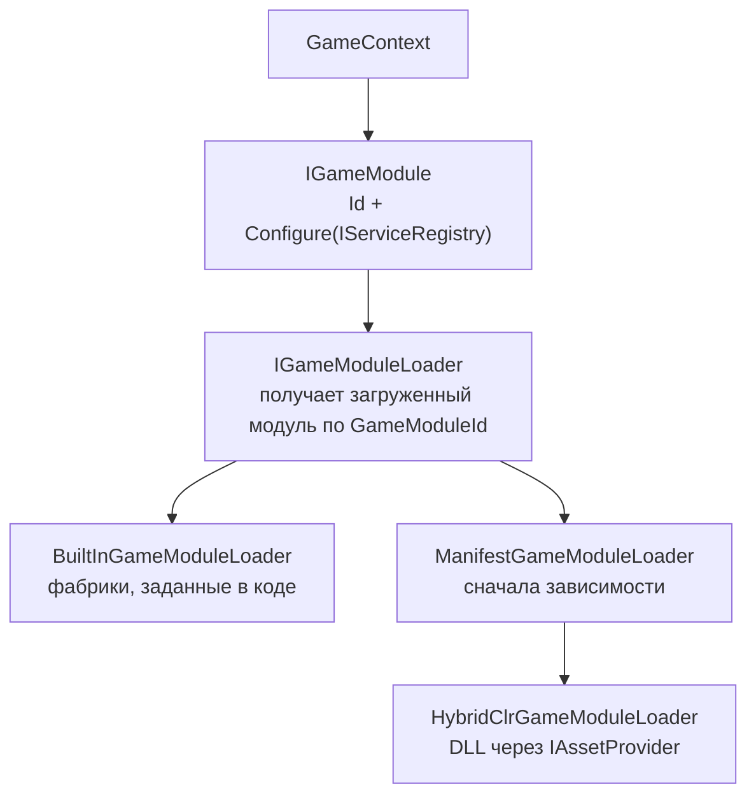

# Игровые модули и горячее обновление

**Игровой модуль** — загружаемая единица DI-композиции. Она даёт общий контракт композиции для
[игрового контекста](game-contexts), независимо от того, входит её код в сборку игрока или загружается отдельно как
сборка горячего обновления.



| Тип | Роль |
| --- | --- |
| `GameModuleId` | Логическая идентичность модуля. Не имя сборки и не адрес: что из этого имеется в виду, решает загрузчик. |
| `IGameModule` | `Id` плюс `Configure(IServiceRegistry)`. Намеренно похож на `IFeatureInstaller`. |
| `IGameModuleLoader` / `IGameModuleHandle` | `LoadAsync(id)` возвращает дескриптор модуля с типизированным свойством `Module`. Дескриптор представляет ресурсы, которыми владеет загрузчик; его уничтожение не означает, что загруженную сборку можно выгрузить. |
| `BuiltInGameModuleLoader` | Получает модули из фабрик времени компиляции. Никакой динамической загрузки. |
| `GameModuleManifest` | Сопоставляет идентификаторы модулей с адресами сборок и зависимостями. Проверка отклоняет неизвестные зависимости и циклы. |
| `ManifestGameModuleLoader` | Загружает модуль после его зависимостей, читая манифест из `IGameModuleManifestSource`, который может предварительно обновить его из скачанного конфига. |
| `CachedGameModuleLoader` | Загружает каждый модуль один раз за процесс (сборку горячего обновления нельзя загрузить дважды). |
| `GameModuleFeatureInstaller` | Преобразует загруженный модуль в `IFeatureInstaller`, чтобы его можно было зарегистрировать так же, как встроенный установщик. |

## Встроенный модуль {#a-built-in-module}

```csharp compile
using System;
using System.Collections.Generic;
using System.Threading;
using Cysharp.Threading.Tasks;
using Foundation.DI;
using Foundation.GameModules;

public sealed class ChallengeModule : IGameModule
{
    public GameModuleId Id => new("challenge");

    public void Configure(IServiceRegistry registry)
    {
        // Зарегистрируйте зависимости режима, как это сделал бы установщик функции.
        registry.Register<ChallengeRules>(ServiceLifetime.Singleton);
    }
}

public sealed class ChallengeRules
{
}

public static class ModuleLoading
{
    public static IGameModuleLoader CreateLoader()
    {
        return new BuiltInGameModuleLoader(new Dictionary<GameModuleId, Func<IGameModule>>
        {
            [new GameModuleId("challenge")] = () => new ChallengeModule(),
        });
    }

    public static async UniTask<IFeatureInstaller> LoadInstallerAsync(
        IGameModuleLoader loader,
        CancellationToken cancellationToken)
    {
        using var handle = await loader.LoadAsync(new GameModuleId("challenge"), cancellationToken);
        return new GameModuleFeatureInstaller(handle.Module);
    }
}
```

`BuiltInGameModuleLoader` отклоняет фабрику, вернувшую `null`, или модуль, чей собственный `Id` отличается от
запрошенного, с `GameModuleLoadException`.

## Манифест {#a-manifest}

`GameModuleManifestEntry(id, assemblyAddress, dependencies)` описывает один модуль. Храните манифест в
конфигурации, а не в коде. Запись содержит идентификатор модуля, адрес его сборки и список зависимостей,
которые нужно загрузить раньше. Добавление режима, изменение адреса сборки или запуск сезонного события можно
оформить как обновление контента, но новый код всё равно может потребовать совместимой сборки плеера или изменений
AOT. Новый модуль или модуль с изменённым адресом доходит до работающего клиента, когда создаётся его загрузчик,
то есть обычно при следующем запуске.

`ManifestGameModuleLoader` создаёт загрузчик сборок один раз по адресам после первого обновления манифеста.
Последующие чтения манифеста могут изменить зависимости, но изменение адреса или добавление модуля после создания
загрузчика не обновляет его таблицу адресов. Для таких изменений нужен новый загрузчик или перезапуск; модуль,
сохранённый в кэше процесса, также остаётся в памяти до перезапуска.

```csharp compile
public static class ManifestExample
{
    public static GameModuleManifest Create()
    {
        return new GameModuleManifest(new[]
        {
            new GameModuleManifestEntry(new GameModuleId("shared"), "modules/shared"),
            new GameModuleManifestEntry(
                new GameModuleId("winter-event"),
                "modules/winter-event",
                new[] { new GameModuleId("shared") }),
        });
    }
}
```

В коде оставляйте только то, что должно входить в основную сборку: резервный контекст и логику, привязанную
к коду, например миграции сохранений.

## Контексты из модулей {#contexts-made-of-modules}

`GameContextDescriptor` называет `GameModuleId`, из которых состоит контекст, а также его идентификатор,
профиль сохранения, отображаемое имя, сезон и окно доступности. `ModularGameContextController` оборачивает
обычный контроллер для таких контекстов:

- обновляет описанные контексты из `IGameContextDescriptorSource` (например, из скачанного конфига);
- входит в запасной контекст вместо контекста вне окна доступности, о чём судит `IGameContextClock`;
- загружает модули контекста через `IGameModuleLoader` и устанавливает их с помощью
  `GameModuleFeatureInstaller`;
- хранит ровно те дескрипторы модулей, которые использует запущенный контекст;
- `IGameContextTransitionHooks` позволяет проекту добавить шаги вокруг переключения (скачивание контента,
  метаданные во время выполнения, общие элементы интерфейса, индикатор загрузки).

`MaterializedGameContextCatalog` хранит дескрипторы и определения, созданные после загрузки модулей. Определение
доступно, пока загружены нужные ему модули, и удаляется после выхода из контекста. В области контейнера каждого
контекста, созданного из модулей, регистрируется `GameContextSeason` с данными о сезоне.

## Горячее обновление с HybridCLR {#hot-update-with-hybridclr}

`Foundation.Infrastructure.HybridClr` — единственный загрузчик на
[HybridCLR](https://hybridclr.doc.code-philosophy.com/). Он компилируется только при установленном
`com.code-philosophy.hybridclr`.

- `HybridClrGameModuleLoader(assetProvider, sources, verifier)` сопоставляет `GameModuleId` с адресом сборки,
  загружает байты через существующий [`IAssetProvider`](content) в `TextAsset`, затем загружает сборку, находит
  единственную реализацию `IGameModule` и создаёт её.
  Это сканирование — единственная рефлексия в цепочке загрузки модулей.
- `HybridClrModuleSource(moduleId, assemblyAddress)` — сопоставление; как выглядят адреса, решает проект.
- `HybridClrAotMetadataPreloader` загружает дополнительные AOT-метаданные для явного списка AOT-сборок. Вызовы
  выполняются последовательно: успешно загруженные метаданные повторно не загружаются, а после ошибки или отмены
  загрузку можно повторить. Прелоадер безопасно вызывать перед каждой загрузкой модуля. Список получите штатным
  инструментом HybridCLR (`HybridCLR/Generate/AOTGenericReference`).
- **Подписанные сборки.** Загружаемая сборка содержит код, который будет выполняться в приложении. `HotUpdateSignature` формирует RSA-подпись
  сборки (SHA-256, PKCS#1 v1.5). Подписывайте её закрытым ключом, который не попадает в приложение; при загрузке
  подпись проверяется открытым ключом, встроенным в AOT-сборку. При необходимости передайте
  `IHotUpdateAssemblyVerifier` (`RsaHotUpdateAssemblyVerifier`) загрузчику и прелоадеру. Верификатор необязателен:
  без него загрузчик не проверяет подлинность содержимого и выполняет любую загружаемую по адресу сборку. Такой режим
  поддерживается, но скомпрометированный или недоверенный источник может доставить код атакующего для выполнения.
  При сетевой загрузке используйте верификатор, если только проект осознанно не принимает этот риск. Подпись доказывает,
  что байты пришли от ключа сборки; версии в ней нет, поэтому более старая сборка, подписанная раньше, проходит проверку
  тоже, и это задумано: какую сборку может
  запускать клиент, решает конфигурация релиза. Её нужно отдавать по HTTPS, чтобы по пути её нельзя было подменить.
  Тем же верификатором можно проверять дополнительные AOT-метаданные.

### Чего он не делает {#what-it-does-not-do}

- **Нет физической выгрузки.** Загрузчик HybridCLR освобождает handle `IAssetProvider` после копирования и проверки
  байтов, до `Assembly.Load`; `Dispose()` возвращённого `IGameModuleHandle` сейчас ничего не делает. Загруженная
  сборка и её типы остаются в памяти на всё время процесса, потому что Community HybridCLR не умеет выгружать сборку,
  размещённую в IL2CPP. Загрузчик запоминает сборку, даже если после её загрузки произошла отмена или ошибка создания
  модуля. При повторной попытке он использует ту же сборку; для загрузки других байтов под тем же идентификатором
  нужно перезапустить процесс.
- **Нет политики версионирования.** К какому адресу привязан модуль, локальный он или удалённый и как
  раскатывается новая версия — решения проекта.
- **Нет обработки MonoBehaviour.** `MonoBehaviour` горячего обновления на префабе Addressables работает,
  потому что Addressables собирает префабы в asset bundle; сборка просто должна быть загружена до создания
  экземпляра префаба.

### Направление зависимостей {#dependency-direction}

`Foundation` никогда не ссылается на HybridCLR или какую-либо сборку горячего обновления. Сборка горячего
обновления может зависеть от `Foundation` ради контракта `IGameModule`, а `Foundation` никогда не должен
зависеть от конкретного типа из сборки горячего обновления.

Для необязательного повтора загрузки подписанной сборки с другого зеркала см. раздел
[Зеркала контента](content-mirroring#integrations).
