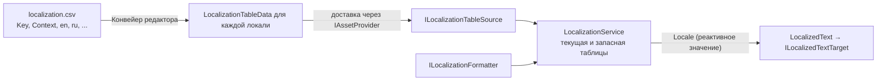

# Локализация

`Foundation` предоставляет выбор локали, поиск переводов по ключу, резервную локаль, форматирование и уведомление
об изменениях. Сторонняя библиотека для локализации или вывода текста не обязательна. Проект задаёт источник
таблиц, форматтер шаблонов и хранилище выбранной локали.



| Тип | Роль |
| --- | --- |
| `LocaleId`, `LocalizationKey`, `LocalizationArguments` | Типы-значения. `LocaleId` сравнивается без учёта регистра и знает свой `Language` (`en` для `en-US`). Строка неявно преобразуется в `LocalizationKey`. |
| `LocalizationSettings` | Поддерживаемые локали и запасная локаль. `TryResolveSupported` отображает `en-GB` в `en`, если поддерживается только `en`. |
| `ILocalizationTableSource` | Загружает `LocalizationTable` одной локали. |
| `ILocalizationFormatter` | Подставляет именованные аргументы в шаблон. Для `string.Format` нужен адаптер, который сопоставит имена аргументов с позиционными параметрами; также можно использовать SmartFormat или собственный форматтер. |
| `ILocalePreferenceStore` | Сохраняет выбранную локаль (`TryLoad`, `Save`). Встроенная реализация — `PlayerPrefsLocalePreferenceStore` (PlayerPrefs, ключ по умолчанию `settings.locale`; `TryLoadSavedLocale` читает значение до создания любых сервисов). |
| `ILocalizationService` / `LocalizationService` | Владеет текущей и запасной таблицей; `Format`, `GetTemplate`, `SetLocaleAsync` и реактивный `Locale`. |

## Построение сервиса {#building-a-service}

```csharp compile
using System;
using System.Collections.Generic;
using System.Globalization;
using System.Threading;
using Cysharp.Threading.Tasks;
using Foundation.Content;
using Foundation.DI;
using Foundation.Lifecycle;
using Foundation.Localization;
using Foundation.Logging;
using Foundation.Serialization;
using Foundation.UI.UGui;
using UnityEngine;
using UnityEngine.UI;

public sealed class AssetLocalizationTableSource : ILocalizationTableSource
{
    private readonly IAssetProvider _assets;
    private readonly ISerializer _serializer;

    public AssetLocalizationTableSource(IAssetProvider assets, ISerializer serializer)
    {
        _assets = assets;
        _serializer = serializer;
    }

    public async UniTask<LocalizationTable> LoadAsync(LocaleId locale, CancellationToken cancellationToken = default)
    {
        using var handle = await _assets.LoadAssetAsync<TextAsset>($"localization/{locale}", cancellationToken);
        return LocalizationTable.FromData(_serializer.Deserialize<LocalizationTableData>(handle.Asset.bytes));
    }
}

public sealed class NamedPlaceholderFormatter : ILocalizationFormatter
{
    public string Format(string template, IReadOnlyDictionary<string, object> arguments)
    {
        var result = template;
        foreach (var pair in arguments)
            result = result.Replace("{" + pair.Key + "}", Convert.ToString(pair.Value, CultureInfo.CurrentCulture));

        return result;
    }
}

public sealed class PlayerPrefsLocaleStore : ILocalePreferenceStore
{
    private const string Key = "locale";

    public bool TryLoad(out LocaleId locale)
    {
        var stored = PlayerPrefs.GetString(Key, string.Empty);
        locale = string.IsNullOrEmpty(stored) ? default : new LocaleId(stored);
        return !locale.IsEmpty;
    }

    public void Save(LocaleId locale) => PlayerPrefs.SetString(Key, locale.Value);
}

public sealed class LocalizationInstaller : IFeatureInstaller
{
    public void Install(IServiceRegistry registry)
    {
        var settings = new LocalizationSettings(
            new[] { new LocaleId("en"), new LocaleId("ru") }, fallbackLocale: new LocaleId("en"));
        registry.RegisterInstance(settings);
        registry.Register<AssetLocalizationTableSource>(ServiceLifetime.Singleton).As<ILocalizationTableSource>();
        registry.Register<NamedPlaceholderFormatter>(ServiceLifetime.Singleton).As<ILocalizationFormatter>();
        registry.Register<PlayerPrefsLocaleStore>(ServiceLifetime.Singleton).As<ILocalePreferenceStore>();
        registry.Register(
            resolver => new LocalizationService(
                resolver.Resolve<ILocalizationTableSource>(),
                resolver.Resolve<ILocalizationFormatter>(),
                settings,
                resolver.TryResolve<IAppLogger>(out var logger) ? logger : null),
            ServiceLifetime.Singleton).As<ILocalizationService>();
        registry.RegisterEntryPoint<LocalizationStartup>();
    }
}

public sealed class LocalizationStartup : IAsyncStartableEntryPoint
{
    private readonly ILocalizationService _localization;
    private readonly ILocalePreferenceStore _store;

    public LocalizationStartup(ILocalizationService localization, ILocalePreferenceStore store)
    {
        _localization = localization;
        _store = store;
    }

    public UniTask StartAsync(CancellationToken cancellationToken)
    {
        var locale = _store.TryLoad(out var saved) ? saved : new LocaleId(CultureInfo.CurrentCulture.TwoLetterISOLanguageName);

        // Использует запасную локаль, если запрошенная не поддерживается или её таблица не загрузилась.
        return _localization.InitializeAsync(locale, cancellationToken);
    }
}
```

`LocalizationService` реализует оба интерфейса: `ILocalizationService` и `ILocalizationSource`. В примере он
регистрируется только как `ILocalizationService`. Если проект использует `LocalizationResolver` для асинхронного
поиска, добавьте `.As<ILocalizationSource>()` к этой же регистрации.

## Поиск и форматирование {#looking-up-and-formatting}

```csharp compile
public sealed class GoldLabelText
{
    private readonly ILocalizationService _localization;

    public GoldLabelText(ILocalizationService localization) => _localization = localization;

    public string Describe(int amount)
    {
        var arguments = new LocalizationArguments(new Dictionary<string, object> { ["amount"] = amount });
        return _localization.Format("hud.gold_label", arguments);
    }
}
```

- `GetTemplate(key)` возвращает исходный шаблон; `Format(key, arguments)` его заполняет. Без аргументов шаблон
  возвращается как есть.
- Сначала ключ ищется в текущей таблице, затем в резервной. Если его нет ни в одной из них, метод возвращает
  `[MISSING:<key>]`. Вместо `null` или исключения интерфейс покажет эту строку, чтобы отсутствующий перевод был заметен.
- `LocalizationKeys` (генерируется из CSV) позволяет использовать константы вместо строковых литералов.

## Смена локали {#switching-locale}

`SetLocaleAsync(locale)` возвращает `false`, если локаль не поддерживается, источник не смог загрузить таблицу
или вернул `null`. Отмена передаётся вызывающему коду. Сервис заменяет таблицы после загрузки, поэтому при ошибке загрузки локаль остаётся
прежней. Затем он передаёт соответствующую `CultureInfo` форматтеру с интерфейсом `ILocalizationCultureAware` и
публикует новое значение `Locale`. Если форматтер выбросит исключение при смене культуры, таблицы уже будут заменены,
а значение локали ещё не будет опубликовано. Сервис не откатывает это изменение. Подпишитесь, чтобы обновить UI,
зависящий от культуры:

```csharp compile
public sealed class LanguageMenu : IDisposable
{
    private readonly ILocalizationService _localization;
    private readonly ILocalePreferenceStore _store;
    private readonly IDisposable _subscription;

    public LanguageMenu(ILocalizationService localization, ILocalePreferenceStore store)
    {
        _localization = localization;
        _store = store;
        _subscription = _localization.Locale.Subscribe(locale => UnityEngine.Debug.Log($"Locale is now {locale}"));
    }

    public async UniTask ChooseAsync(string localeCode, CancellationToken cancellationToken)
    {
        var locale = new LocaleId(localeCode);
        if (await _localization.SetLocaleAsync(locale, cancellationToken))
            _store.Save(locale);
    }

    public void Dispose() => _subscription.Dispose();
}
```

## Текст на экране: `LocalizedText` {#text-on-screen-localizedtext}

`LocalizedText` из сборки `Foundation.UI.UGui` добавляется к объекту интерфейса. Он хранит ключ и аргументы
перевода и обновляет текст при смене локали. Компонент не зависит от способа вывода текста: ваш проект реализует
`ILocalizedTextTarget.SetText(string)` для используемого рендерера (например, TextMeshPro или UniText).

```csharp compile
public sealed class UiTextTarget : MonoBehaviour, ILocalizedTextTarget
{
    [SerializeField] private Text text;

    public void SetText(string value) => text.text = value;
}
```

Назначьте целевой компонент в поле `LocalizedText.textTarget` и укажите ключ перевода в инспекторе или через
`SetKey`. Аргументы можно задать в инспекторе или методами `SetArgument` и `SetArguments`. `LocalizedText` получает
`ILocalizationService` через `IServiceResolverClient`, поэтому его должен создавать или внедрять объект с
зарегистрированным инжектором: например, UI-роутер, пул префабов или корневой компонент сцены.

Состояния `FoundationButton` могут нести ключ локализации и аргументы таким же образом.

## SmartFormat {#smartformat}

`Foundation.Infrastructure.SmartFormat` — необязательный `ILocalizationFormatter` на
[SmartFormat](https://github.com/axuno/SmartFormat) (NuGet `SmartFormat`, проверено на 3.6.1). Его включает
`FOUNDATION_SMARTFORMAT`, который **Finish Setup** выставляет, когда DLL есть в проекте. `UseSmartFormat`
регистрирует его, а `UseLocalization<TTableSource>` — перегрузка, которая оставляет форматтер вам:

```csharp compile
using Foundation.DI;
using Foundation.Infrastructure.SmartFormat;
using Foundation.Localization;
using SmartFormat.Extensions;

public sealed class SmartFormatLocalizationInstaller : IFeatureInstaller
{
    public void Install(IServiceRegistry registry)
        => registry
            .UseLocalization<AssetLocalizationTableSource>(
                new LocalizationSettings(new[] { new LocaleId("en"), new LocaleId("ru") }, fallbackLocale: new LocaleId("en")))
            .UseSmartFormat(formatter => formatter.RemoveFormatterExtension<PluralLocalizationFormatter>());
}
```

Форматтер реализует `ILocalizationCultureAware` и использует культуру текущей локали для чисел и словоформ.
`LocalizationCsvValidator` проверяет ключи и плейсхолдеры, но не разбирает шаблоны SmartFormat. Вызовы без
аргументов обходят форматтер. Если форматирование с аргументами завершается ошибкой, `LocalizedText` записывает её
в лог и показывает исходный шаблон. Чтобы выявлять синтаксические ошибки SmartFormat при проверке контента, добавьте
валидатор с той же конфигурацией форматтера, что используется в рантайме. В примере настройка SmartFormat отключает расширение множественного числа: это подходит,
если проект использует только условные формы. Без такого вызова сохраняются настройки SmartFormat по умолчанию.
Если адаптер не установлен, форматтер регистрирует сам проект.

## Создание: CSV-конвейер {#authoring-the-csv-pipeline}

```text
Google Sheets / Excel → CSV в UTF-8 → проверка → генерация LocalizationKeys → файлы локалей → Addressables → IAssetProvider
```

В CSV используются столбцы `Key,Context,<locale>,<locale>,...`. `Key` и `Context` содержат метаданные; каждый
следующий столбец соответствует локали. Чтобы добавить язык, достаточно добавить столбец — менять код не нужно.
Инструменты редактора находятся в `Foundation.Content.Editor` и не требуют сторонних библиотек. Они читают CSV
встроенным средством и записывают двоичные файлы через [сериализатор сборки контента](config#the-binary-format):

| Тип | Роль |
| --- | --- |
| `LocalizationCsvReader` / `LocalizationCsvSource` | Читает `localization.csv` в `LocalizationDocument`. |
| `LocalizationCsvValidator` | Проверяет отсутствующие и дублирующиеся ключи перед экспортом. |
| `LocalizationPlaceholders` | Проверяет, что плейсхолдеры `{name}` одного ключа согласованы между локалями. |
| `LocalizationCsvExporter` | Создаёт по одной `LocalizationTableData` на столбец локали. |
| `LocalizationKeysGenerator` | Записывает исходники `LocalizationKeys` и `LocalizationLocales` из столбца ключей. |
| `LocalizationBuildSettings` | Ваша выходная папка, пространство имён и путь к CSV. |

Не зашивайте поддерживаемые языки в код импортёра и не зашивайте видимые игроку строки в C#.

## Вёрстка и более длинный текст {#layout-and-longer-text}

Корректность локализации включает вёрстку. Когда на экране много локализованного текста, посмотрите его в
локали, где строки, вероятно, окажутся длиннее: обрезка, перенос, рост кнопок и сочетания «число + суффикс» не
видны только по английскому.
