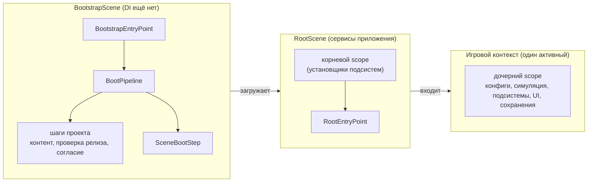

# Композиция приложения

Здесь показано, как соединить части Foundation и куда добавить код проекта. Можно подключить только нужные
механизмы: низкоуровневые сервисы работают и без полного цикла запуска приложения. Для полной композиции
понадобятся собственные шаги запуска, установщики подсистем и игровые контексты.



## 1. Загрузка: до появления контейнера {#1-boot-before-the-container-exists}

`BootstrapEntryPoint` — компонент первой сцены. Без изменений он загружает сцену с индексом `rootSceneIndex`.
Проект может унаследовать этот компонент и добавить действия, которые должны выполниться перед загрузкой сцены.
Шаги запуска выполняются до создания DI-контейнера, поэтому необходимые зависимости им передаются отдельно.

У `IBootStep` есть имя `Name` для профайлера (`Foundation.Boot.<Name>`), вес `Weight` для индикатора загрузки
(значение `0` не меняет индикатор) и метод `RunAsync`. Метод сообщает прогресс от 0 до 1 и возвращает
`Continue` или `Stop`. `BootPipeline` выполняет шаги по очереди и обновляет индикатор через `ILoadingCurtain`.
Если шаг намеренно вернул `Stop`, компонент запуска вызывает `OnBootStopped`. Исключения из `OnBeforeBoot` и шагов
передаются в `OnBootFailed`.

```csharp compile
using System;
using System.Collections.Generic;
using System.Threading;
using Cysharp.Threading.Tasks;
using Foundation.DI;
using Foundation.GameContexts;
using Foundation.Lifecycle;
using UnityEngine;

public sealed class MinimalCurtain : ILoadingCurtain
{
    public void BeginReload()
    {
    }

    public void CancelReload()
    {
    }

    public UniTask CompleteAsync() => UniTask.CompletedTask;

    public void AdvanceStep(string status)
    {
    }

    public void SetTransitionProgress(float progress)
    {
    }

    public void AdvanceWeightedStep(int weight, string status)
    {
    }

    public void SetWeightedStepFraction(float fraction, int weight, string status)
    {
    }

    public void ShowFatalError(string title, string description) => Debug.LogError($"{title}: {description}");

    public void ShowWaitingForConnection(string title, string description)
    {
    }

    public void ClearWaitingForConnection()
    {
    }
}

public sealed class MyBootstrap : BootstrapEntryPoint
{
    private readonly MinimalCurtain _curtain = new();

    protected override ILoadingCurtain Curtain => _curtain;

    protected override void OnBeforeBoot() => Debug.Log("Boot starts");

    protected override IReadOnlyList<IBootStep> CreateSteps() => new IBootStep[]
    {
        new DelegateBootStep("Consent", 1, (progress, cancellationToken) => AskConsentAsync(cancellationToken)),
        new SceneBootStep(RootSceneIndex),
    };

    protected override void OnBootFailed(Exception exception) => _curtain.ShowFatalError("Boot failed", exception.Message);

    protected override void OnBootStopped() => Debug.Log("Boot stopped by a step that handled its own result");

    private static UniTask AskConsentAsync(CancellationToken cancellationToken) => UniTask.CompletedTask;
}
```

Готовые шаги:

| Шаг | Где | Что делает |
| --- | --- | --- |
| `SceneBootStep` | ядро | Загружает корневую сцену. Разместите его последним в списке шагов. |
| `DelegateBootStep` | ядро | Оборачивает вашу фазу в делегат; класс не нужен. |
| `ContentStartupBootStep` | [адаптер Addressables](../adapters/addressables) | Инициализирует Addressables, при необходимости проверяет версию клиента и загружает недостающий контент. При стратегии `ContentStartupStrategy.Standard` инициализирует Addressables и, если задана, выполняет дополнительную проверку. |
| `YooAssetContentStartupBootStep` | [адаптер YooAsset](../adapters/yooasset) | Выполняет ту же фазу для пакета YooAsset в режиме host с тем же выбором стратегии. |

Шаг может завершить загрузку намеренно, вернув `BootStepOutcome.Stop` (например, при обязательном обновлении);
компонент вызывает `OnBootStopped`, а не `OnBootFailed`. Если загрузку корневой сцены не удалось начать, возникает
исключение, которое передаётся в `OnBootFailed`. Конвейер переживает сцену загрузки: загрузка корневой сцены
выгружает её, а последние шаги всё равно завершаются. Конвейер выполняет шаги в переданном порядке и не проверяет
положение шага загрузки сцены.

## 2. Корневая область: сервисы приложения {#2-the-root-scope-application-services}

Компонент сцены наследуется от `VContainerRootScope<TEntryPoint>` (или аналога для вашего контейнера) и
возвращает список установщиков проекта типа `IFeatureInstaller`. Установщик — единица расширения: он получает `IServiceRegistry` и
регистрирует то, что нужно одной подсистеме, не упоминая контейнер. Сюда относятся сервисы, принадлежащие
приложению: провайдер контента, локализация, аудио, аналитика, реклама и репозиторий сохранений. Всё, что
принадлежит запущенной игре, идёт в её контекст.

Ссылки на сцену, которые контейнер создать не может (корни UI, экран загрузки), привязываются в
`PrebindActions`.

```csharp compile
using Foundation.Audio;
using Foundation.Infrastructure.VContainer;
using Foundation.Messaging;
using Foundation.Pooling;

public sealed class AppEntryPoint : RootEntryPoint
{
    private readonly IGameContextController _contexts;

    public AppEntryPoint(IGameContextController contexts) => _contexts = contexts;

    protected override async UniTask RunAsync(CancellationToken cancellation)
        => await _contexts.EnterStartupContextAsync(cancellation);
}

public sealed class AppScope : VContainerRootScope<AppEntryPoint>
{
    [SerializeField] private Transform uiRoot;

    protected override IReadOnlyList<IFeatureInstaller> FeatureInstallers => new IFeatureInstaller[]
    {
        new PoolingInstaller(),
        new AudioInstaller(new IAudioChannelDefinition[] { new AudioChannelDefinition("ui") }),
    };

    protected override void PrebindActions(IServiceRegistry registry)
    {
        registry.RegisterMessaging();
        registry.RegisterInstance(uiRoot);
    }
}
```

Точка входа наследуется от `RootEntryPoint`. Метод `RunAsync` задаёт последовательность запуска и обычно
заканчивается вызовом `IGameContextController.EnterStartupContextAsync`. Для работы примера также нужна регистрация
`IGameContextController` и его зависимостей, зависящая от проекта и опущенная в `AppScope`. Если область DI-контейнера уничтожается
во время этой работы — например, при выходе из Play Mode или завершении приложения, — операция отменяется без
сообщения об ошибке запуска.

## 3. Игровые контексты: по одной игре за раз {#3-game-contexts-one-game-at-a-time}

Игровой контекст объединяет конфигурации, сохранения и подсистемы одного игрового режима; подробнее см.
[Игровые контексты](../app/game-contexts). Контекст можно встроить в приложение через `GameContextDefinition`
и список установщиков либо описать через `GameContextDescriptor`. Во втором случае `ModularGameContextController`
загружает указанные в дескрипторе модули (см. [Игровые модули](../app/game-modules)).

Проект может хранить список модулей и их зависимости в собственной конфигурации, например в группе
`game_modules`. Запись может содержать идентификатор модуля, адрес сборки и зависимости. Для игрового режима
в ней также можно указать идентификатор контекста, пространство имён и версию сохранений, отображаемое имя
и период доступности. Foundation предоставляет интерфейсы манифеста и дескрипторов, но не задаёт формат
этой конфигурации.
Эти записи можно менять обновлением контента, но таблица адресов сборок фиксируется при создании загрузчика модулей.
Ограничения на добавление модулей и изменение адресов описаны в разделе [Игровые модули](../app/game-modules#a-manifest).
В коде оставьте только те данные, которые действительно должны быть частью приложения, например резервный
контекст или миграцию сохранений, привязанную к коду.

## Точки расширения {#extension-points}

| Чтобы добавить | Реализуйте | Регистрируется или перечисляется в |
| --- | --- | --- |
| Фазу запуска | `IBootStep` или `DelegateBootStep` | `BootstrapEntryPoint.CreateSteps` |
| Что показывать во время загрузки | `ILoadingCurtain` | `BootstrapEntryPoint.Curtain` |
| Сервис приложения | `IFeatureInstaller` | `FeatureInstallers` корневой области контейнера |
| Работу при создании области | `IStartableEntryPoint`, `IAsyncStartableEntryPoint`, `ITickableEntryPoint` | `registry.RegisterEntryPoint<T>()` |
| Игру или режим | `IGameModule` и запись манифеста проекта | конфиг-манифест |
| Шаги вокруг смены контекста | `IGameContextTransitionHooks` | `ModularGameContextController` |
| Игровую подсистему | `IFeatureInstaller`, `IFeatureSaveModule` | установщики контекста |
| Новую реализацию порта | интерфейс порта (`IAssetProvider`, `IEventBus`, ...) | установщик; см. [Адаптеры](../adapters/overview) |
