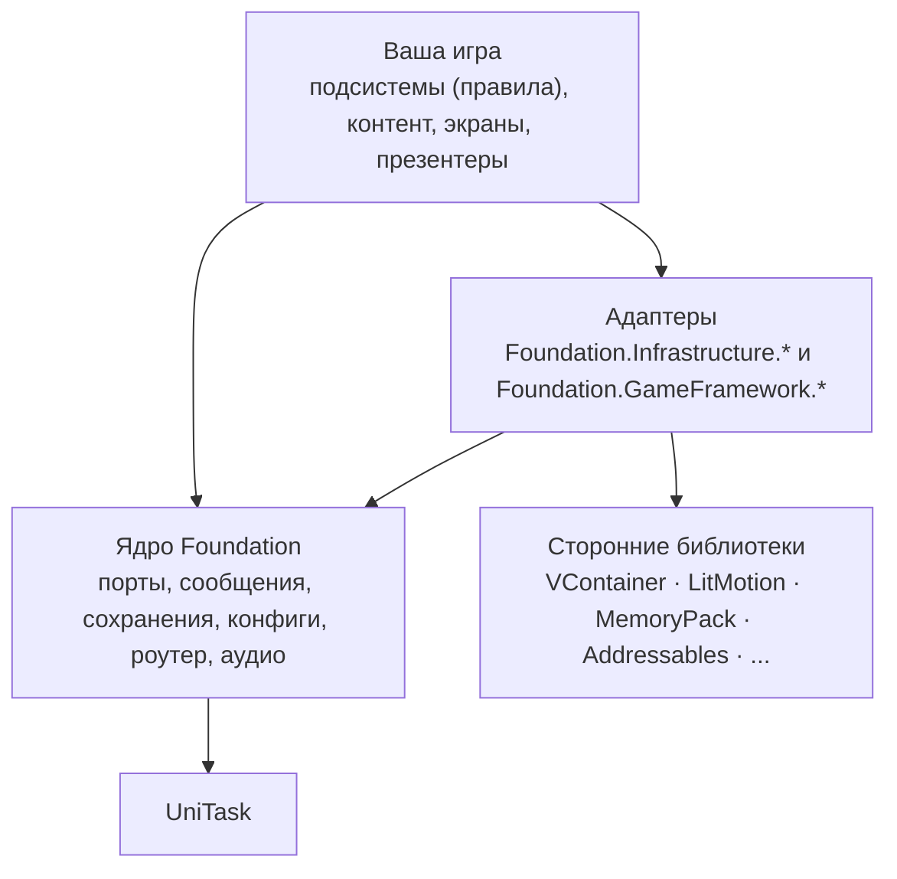
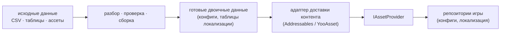

# Архитектура

Foundation предоставляет общие механизмы, а проект задаёт правила игры, контент и интерфейс. Такое разделение
позволяет использовать инфраструктуру в другой игре, не перенося туда правила первой.

## Слои {#layers}

- **Ядро** определяет контракты (порты) и предоставляет готовые реализации там, где можно выбрать разумное
  поведение по умолчанию. Единственная обязательная сторонняя библиотека для основной сборки `Foundation` — UniTask;
  модули, предназначенные для Unity, также используют API движка. Сам пакет указывает `com.unity.ugui` в `package.json`;
  полный список зависимостей см. в [инструкции по установке](../getting-started/installation).
- **Адаптеры** реализуют порт поверх сторонней библиотеки. Их сборки компилируются при наличии необходимых пакетов
  и символов компиляции; точные условия зависят от интеграции.
- **Ваша игра** компонует и то и другое. Игровые правила, экономика, прогрессия и схемы контента никогда не
  должны попадать в пакет.

## Порты и адаптеры {#ports-and-adapters}

Порт — небольшой интерфейс в `Foundation` (`ISerializer`, `IAssetProvider`, `IRandomService`,
`IServiceRegistry`, ...). Большинство сборок адаптеров следует схеме именования
`Foundation.Infrastructure.<Library>`, но мобильные и некоторые UI-интеграции называются иначе (см. раздел
[Адаптеры](../adapters/overview)). Unity автоматически выставляет часть символов компиляции по метаданным пакетов;
для других интеграций при настройке проекта нужно задать дополнительный символ. Адаптеры изолируют большинство прямых ссылок на сторонние библиотеки в runtime-коде. Исключение — генератор Typed IDs:
при включённой поддержке MemoryPack он создаёт форматтеры, использующие типы MemoryPack.

Порты позволяют подсистемам использовать прежние интерфейсы при замене адаптера. При этом проекту нужно настроить
новый backend и способ доставки контента. При смене формата сериализации также потребуется пересобрать контент и
решить, как читать или мигрировать существующие сохранения: замена регистрации не преобразует записанные данные.
Список адаптеров, проверенные версии и инструкции по созданию своего адаптера приведены в разделе
[Адаптеры](../adapters/overview).

UniTask — исключение: он используется в асинхронном API, а не скрывается за портом реализации. Если на вашей
границе нужен другой тип задачи, преобразуйте там (`UniTask` ⇄ `Task`/`Awaitable`).

## Подсистемы владеют своим состоянием {#features-own-their-state}

*Подсистема* — самостоятельная часть игровой логики с `IFeatureInstaller`, собственным состоянием во время выполнения и,
если она сохраняется, собственным сегментом сохранения.

- Состояние подсистемы во время выполнения доступно только ей. Другая подсистема не должна читать или изменять его.
- Взаимодействие между подсистемами идёт через явные возможности: интерфейс сервиса, который выставляет
  владеющая подсистема, [команду](../core/messaging), запрос, возвращающий модель для чтения, или событие.
- UI читает состояние через запросы или модели для чтения, но никогда через внутреннее состояние подсистемы.

Так зависимости остаются явными: если подсистеме A нужна подсистема B, это видно в конструкторе A.

## У сообщений есть смысл {#messages-have-meanings}

Три шины, три разных контракта (см. [Сообщения](../core/messaging)):

| | Значит | Обработчиков |
| --- | --- | --- |
| Команда | «Сделай это» (изменяет состояние) | ровно один |
| Запрос | «Скажи мне это» (читает состояние) | ровно один |
| Событие | «Это произошло» (факт в прошедшем времени) | любое число |

События никогда не отменяют изменение, поэтому событий `BeforeX` нет: валидация живёт в обработчике команды.
Не каждый вызов метода должен быть командой; используйте её там, где запрос пересекает границу подсистемы или
где полезна трассировка.

## Симуляция не зависит от представления {#simulation-is-independent-of-presentation}

Логику, состояние которой меняется со временем (например, производство, таймеры или бой), выполняйте в
[раннере симуляции](../core/simulation) или [планировщике](../core/time-scheduling-random), а не в UI.
Интерфейс только отображает состояние и не управляет тиками. Симуляция может работать без видимого UI, пока приложение
выполняет кадры, и её можно тестировать без объектов Unity. Это не гарантирует выполнение в фоне, когда операционная
система приостановила приложение.

## Создание контента отделено от доставки {#content-authoring-is-separate-from-delivery}

Два разных конвейера легко перепутать:

*Создание* решает, как данные превращаются в скомпилированный контент; *доставка* решает, как эти файлы
попадают на устройство. Метки и группы доставки не определяют игровые схемы, а валидаторы не содержат логики
загрузки. Баланс и настройки держите в контенте, а не в коде подсистем. См. [Конфиги](../app/config),
[Контент](../app/content) и [Локализацию](../app/localization).

## Что читать дальше {#where-to-go-from-here}

- [Композиция приложения](app-composition): как сочетаются загрузка, корневая область контейнера и игровые контексты.
- [Быстрый старт](../getting-started/quick-start): минимальный рабочий пример за несколько минут.
- [Адаптеры](../adapters/overview): порты и то, что их реализует.
