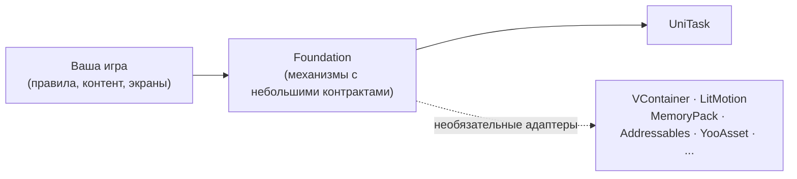

# Foundation

Foundation — это инфраструктурный пакет для Unity 6000.5 и новее (`com.fzfking.foundation`). Он предоставляет
механизмы запуска приложения, управления временем жизни сервисов, сохранения данных и показа интерфейса.
Foundation включает минимальные типы реактивных значений и потоков событий: их можно использовать напрямую или
связать с другой реактивной библиотекой на границах проекта. Проект выбирает DI-контейнер, сериализатор и библиотеку
анимации.

## Принципы {#principles}

- **Порты и адаптеры.** Foundation обращается к сторонним библиотекам через небольшие интерфейсы — порты.
  Отдельные сборки-адаптеры реализуют эти интерфейсы и компилируются при выполнении условий конкретной
  интеграции: может требоваться соответствующий пакет, символ компиляции или и то и другое.
  [UniTask](https://github.com/Cysharp/UniTask) — единственная обязательная сторонняя зависимость: библиотека
  для асинхронного кода.
- **Инфраструктура общего назначения.** Экономика, прогрессия, правила боя и схемы контента остаются в вашем
  проекте.
- **Явная регистрация подсистем.** Установщик `IFeatureInstaller` регистрирует сервисы через
  `IServiceRegistry`. Корневой компонент применяет установщики, не привязывая их к конкретному DI-контейнеру.

## Что внутри {#what-is-in-it}

| Область | Что вы получаете | С чего начать |
| --- | --- | --- |
| Композиция | DI-интерфейсы, установщики подсистем, точки входа, запуск приложения, корневая область DI-контейнера | [Быстрый старт](getting-started/quick-start), [Композиция приложения](concepts/app-composition) |
| Игровые контексты | Одна активная игра, её конфигурации и отдельное пространство имён сохранений; загружаемые игровые модули | [Игровые контексты](app/game-contexts) |
| Сообщения | Команды, запросы и события с трассировкой при разработке | [Сообщения](core/messaging) |
| Логика | Конечный автомат, симуляция с фиксированным шагом, планировщик, требования, награды, флаги функциональности | [Конечный автомат](core/state-machine), [Симуляция](core/simulation) |
| Сохранения | Сегментированное сохранение: каждая подсистема владеет своим фрагментом | [Сохранения](app/save) |
| Данные и контент | Группы конфигов, провайдер ассетов, локализация | [Конфиги](app/config), [Контент](app/content), [Локализация](app/localization) |
| Интерфейс | Навигация по экранам, не зависящая от конкретной UI-системы; компоненты uGUI, вкладки, всплывающие подсказки, бейджи и звуковые или тактильные отклики | [UI-роутер](ui/router) |
| Системы | Аудио, пулы объектов, типизированные идентификаторы, скриптовые последовательности, обучение, анимация и асинхронное создание объектов с бюджетом времени интеграции на кадр | [Аудио](systems/audio), [Обучение](systems/tutorial), [Анимация](core/reactive-motion), [Контент](app/content) |
| Релиз | Политика версий клиента и удалённая конфигурация релизов | [Контроллер релизов](app/release) |
| Мобильные сервисы | Реклама, покупки, идентификация, уведомления, облачные сохранения и интеграции аналитики | [GameFramework](gameframework/overview) |

## Игры на Foundation {#games-built-with-foundation}

- [Vampires World Idle](https://play.google.com/store/apps/details?id=com.freedominteractive.vampireWorldIdle) от Freedom Interactive Studios: игра в жанре idle tycoon о вампирах для Android.

Сделали игру на Foundation? Откройте issue или pull request, чтобы добавить её сюда.

## Как читать эту документацию {#how-to-read-this-documentation}

1. Начните с [установки](getting-started/installation) и [быстрого старта](getting-started/quick-start), чтобы
   собрать и запустить минимальное приложение.
2. В разделах [Архитектура](concepts/architecture) и [Композиция приложения](concepts/app-composition) объясняется устройство пакета и то, как проект подключает к нему собственный код.
3. Разделы **Ядро**, **Приложение**, **UI** и **Системы** — независимые руководства; читайте те, что нужны.
4. [Адаптеры](adapters/overview) перечисляют порты, библиотеки, которые их реализуют, и правила создания собственного адаптера.

Примеры с меткой `csharp compile` рассчитаны на совместную компиляцию в пределах одной страницы при наличии
нужных адаптеров. Остальные C#-блоки содержат фрагменты или показывают недопустимое использование.
