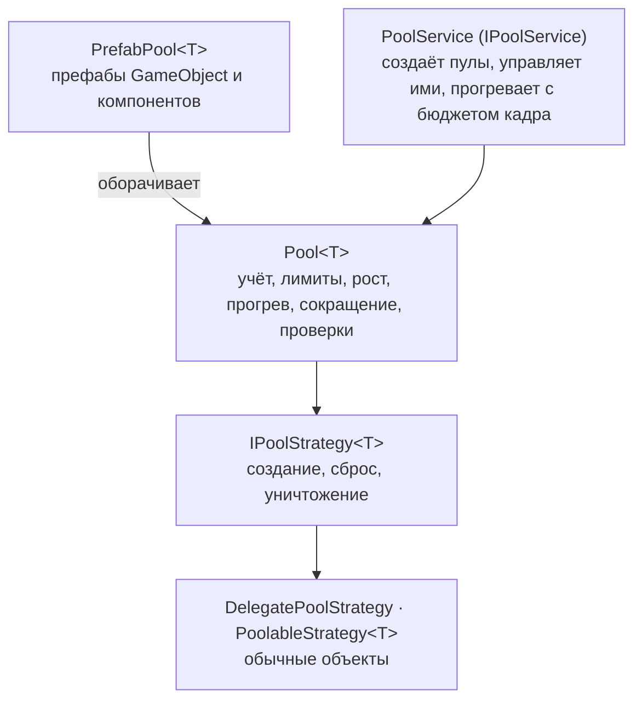

# Пулы

Универсальные пулы с прогревом, лимитами, сокращением простаивающих экземпляров, проверками владения и
статистикой.



`Pool<T>` ничего не знает об объектах Unity: как экземпляр создаётся, активируется, сбрасывается и
уничтожается — дело стратегии. `T` — намеренно класс, чтобы обобщённый код разделялся на IL2CPP и HybridCLR.

## Настройка {#setup}

`PoolingInstaller` регистрирует `IPoolService`. Установите его до всего, что берёт объекты из пулов (системе
[аудио](audio) он нужен).

```csharp compile
using System;
using System.Threading;
using Cysharp.Threading.Tasks;
using Foundation.Content;
using Foundation.DI;
using Foundation.Pooling;
using UnityEngine;

public sealed class PoolsFeature : IFeatureInstaller
{
    public void Install(IServiceRegistry registry) => new PoolingInstaller().Install(registry);
}
```

## Обычные объекты {#plain-objects}

Объект из пула реализует `IPoolable` (или передайте делегаты). Пул вызывает хуки; больше он ничего не
сбрасывает.

```csharp compile
public sealed class Bullet : IPoolable
{
    public Vector3 Position { get; set; }

    public void OnCreated()
    {
    }

    public void OnRented()
    {
    }

    public void OnReturned() => Position = default;

    public void OnDestroying()
    {
    }
}

public sealed class BulletSpawner
{
    private readonly Pool<Bullet> _bullets = new(
        PoolId.From("bullets"),
        new PoolableStrategy<Bullet>(() => new Bullet()),
        new PoolSettings(prewarmCount: 32, maxRetained: 128));

    public void Fire(Vector3 from)
    {
        var bullet = _bullets.Rent();
        bullet.Position = from;
        _bullets.Return(bullet);
    }

    public void FireScoped(Vector3 from)
    {
        using var lease = _bullets.Lease();
        lease.Item.Position = from;
    }
}
```

`Lease()` возвращает элемент в пул при уничтожении. Для значения, которому хуки не нужны, `ObjectPool<T>` —
пул поменьше, построенный из делегатов, а `DelegatePoolStrategy<T>` делает то же для `Pool<T>`.

## Префабы {#prefabs}

`IPoolService.CreatePrefabPool` создаёт пул экземпляров уже загруженного префаба. Экземпляры ждут под
неактивным контейнером, поэтому не получают `Awake`, `OnEnable` и `Update`, пока не будут взяты. При выдаче
экземпляра пул меняет его родителя.

```csharp compile
public sealed class RowView : PoolableBehaviour
{
    protected override void OnPoolReturned()
    {
        // Отмените то, что было запущено при аренде: подписки, анимации и привязку данных.
    }
}

public sealed class RowList
{
    private readonly PrefabPool<RowView> _rows;

    public RowList(IPoolService pools, RowView rowPrefab)
        => _rows = pools.CreatePrefabPool(PoolId.From("rows"), rowPrefab);

    public RowView Add(Transform listRoot) => _rows.Rent(listRoot);

    public void Remove(RowView row) => _rows.Return(row);
}
```

`PoolableBehaviour` — базовый класс, пробрасывающий четыре хука в `OnPoolCreated`, `OnPoolRented`,
`OnPoolReturned` и `OnPoolDestroying` и предоставляющий `PoolLifetime` — токен, отменяемый при возврате
экземпляра. Он сообщает об отмене асинхронной работе, начатой во время аренды; работа остановится, только если
она проверяет и учитывает этот токен:

```csharp compile
public sealed class PulsingRow : PoolableBehaviour
{
    protected override void OnPoolRented() => PulseAsync(PoolLifetime).Forget();

    private async UniTaskVoid PulseAsync(CancellationToken cancellationToken)
    {
        while (!cancellationToken.IsCancellationRequested)
        {
            transform.localScale = Vector3.one * (1f + 0.05f * Mathf.Sin(Time.time * 4f));
            await UniTask.Yield(cancellationToken).SuppressCancellationThrow();
        }
    }
}
```

### Префабы, загружаемые через провайдер ассетов {#prefabs-loaded-through-the-asset-provider}

Когда префаб нужно загрузить, передайте пулу `IPrefabSource`. Пул владеет загруженным ассетом и освобождает
его после уничтожения своих экземпляров — именно тогда провайдер может его выгрузить.
`AssetProviderPrefabSource` загружает через [`IAssetProvider`](../app/content); `DirectPrefabSource`
оборачивает ссылку, которая у вас уже есть.

```csharp compile
public sealed class EnemyView : PoolableBehaviour
{
}

public sealed class EnemyPools
{
    private readonly IPoolService _pools;
    private readonly IAssetProvider _assets;

    public EnemyPools(IPoolService pools, IAssetProvider assets)
    {
        _pools = pools;
        _assets = assets;
    }

    public UniTask<PrefabPool<EnemyView>> CreateAsync(CancellationToken cancellationToken)
        => _pools.CreatePrefabPoolAsync<EnemyView>(
            PoolId.From("enemy"),
            new AssetProviderPrefabSource(_assets, "enemies/zombie"),
            new PoolSettings(prewarmCount: 20, maxRetained: 40),
            cancellationToken);
}
```

При создании экземпляров префабов [`IGameObjectInjector`](../core/di#injecting-monobehaviours) внедряет в их
компоненты зависимости из соответствующей области контейнера.

## Настройки {#settings}

`PoolSettings` (сериализуемые, поэтому могут лежать в инспекторе):

| Настройка | Значение |
| --- | --- |
| `PrewarmCount` | Простаивающие экземпляры, к которым стремится вызов прогрева. Пул никогда не прогревается сам. |
| `MinRetained` / `MaxRetained` | Сколько простаивающих экземпляров хранить. Возврат сверх `MaxRetained` уничтожает экземпляр (0 — без ограничений). |
| `MaxActive` / `ExhaustedBehavior` | Предел взятых экземпляров; на пределе взятие возвращает null (`ReturnNull`) или бросает исключение (`Throw`). |
| `GrowthBatch` | Сколько экземпляров создаётся, когда взятие находит пул пустым: один для вызывающего, остальные простаивают. |
| `IdleTrimSeconds` / `TrimBatchSize` | Уничтожать экземпляры, простаивающие дольше этого времени, вплоть до `MinRetained`, не более этого числа за проверку. |

`Validate()` перечисляет проблемы. Конструктор отклоняет жёсткие ошибки; «прогрев превышает max retained» —
лишь предупреждение.

## Прогрев {#prewarming}

```csharp compile
public sealed class LoadingScreenPrewarm
{
    private readonly IPoolService _pools;

    public LoadingScreenPrewarm(IPoolService pools) => _pools = pools;

    public UniTask RunAsync(IProgress<float> progress, CancellationToken cancellationToken)
        => _pools.PrewarmAllAsync(budgetMillisecondsPerFrame: 1.0, progress, cancellationToken);
}
```

Прогрев с бюджетом создаёт экземпляры, пока не исчерпан бюджет кадра (всегда хотя бы один за кадр), затем
уступает. `Prewarm(target)` выполняется синхронно и может вызвать скачок времени кадра.
`Pool<T>.PrewarmAsync(target, instancesPerFrame)` распределяет фиксированное число объектов по кадрам;
`PrefabPool<T>` и `IPool<T>` предоставляют перегрузку с бюджетом времени. Вызывайте `PrewarmAllAsync`, пока показан
экран загрузки.

## Одно представление на сущность {#one-view-per-entity}

`KeyedViewSet<TKey, TView>` хранит по одному представлению из пула для каждого идентификатора. Синхронизацию
нужно обрамлять вызовами `BeginSync` и `EndSync`: для каждого запрошенного идентификатора представление
остаётся в наборе или арендуется у пула, если пул может выделить экземпляр; остальные возвращаются в пул.
Если ёмкости внутренних коллекций достаточно для пикового числа активных идентификаторов, синхронизация в этих
пределах не выделяет память.

```csharp compile
public sealed class EnemyViewSync
{
    private readonly KeyedViewSet<int, EnemyView> _views;

    public EnemyViewSync(IPool<EnemyView> pool) => _views = new KeyedViewSet<int, EnemyView>(pool);

    public void Sync(ReadOnlySpan<int> aliveEnemyIds)
    {
        _views.BeginSync();

        foreach (var id in aliveEnemyIds)
        {
            var view = _views.Acquire(id, out var created);
            if (created && view != null)
                view.transform.localPosition = Vector3.zero;
        }

        _views.EndSync();
    }
}
```

Используйте `EndSync(List<TView> retired)`, если для исчезнувших представлений сначала нужно проиграть анимацию ухода;
затем верните их через `Recycle`.

## Диагностика и безопасность {#diagnostics-and-safety}

`PoolStats` сообщает `Created`, `Active`, `Inactive`, `PeakActive`, `RentCount`, `ReturnCount`, `Misses`
(взятие не нашло простаивающего экземпляра), `Expansions`, `Rejected` (`MaxActive`), `Destroyed` и
`SuggestedPrewarm` (наблюдаемый пик: данные, а не автонастройка).
`IPoolService.Collect(List<IPool>)` перечисляет пулы, которыми владеет сервис; `PoolRegistry.Collect(List<IPool>)`
перечисляет все живые пулы в редакторе и development-сборках, а в остальных сборках ничего не делает.

Каждая сборка отслеживает взятые экземпляры по ссылкам, поэтому **двойной возврат** и **возврат не в тот пул**
отклоняются до повреждения списка простаивающих объектов. Взятие или `Adopt` после уничтожения пула сообщаются
в каждой сборке.
Проверки в редакторе и development-сборках (`PoolDefaults.SafetyChecks`) дополняют сообщения о владельце и
обнаруживают **утечки при уничтожении**. Нарушение отправляется в `IPoolViolationHandler` (по умолчанию
`LoggingPoolViolationHandler`; в тестах задайте `PoolDefaults.ViolationHandler` равным
`ThrowingPoolViolationHandler.Instance`) и игнорируется, так что пул остаётся согласованным.

## Владение {#ownership}

- Пул владеет своими экземплярами; вызывающий владеет взятым экземпляром, пока не вернёт его.
- `PoolService` владеет созданными им пулами (`Release(id)` уничтожает один) и корнем `DontDestroyOnLoad`,
  поэтому пулы переживают загрузки сцен. Экземпляр, помещённый в сцену, которая затем выгружена,
  обнаруживается и отбрасывается, а не переиспользуется.
- Уничтожение пула со взятыми экземплярами сообщает `LeakedOnDispose` в development-сборках; возвращённые
  позже экземпляры уничтожаются.

## HybridCLR и IL2CPP {#hybridclr-and-il2cpp}

`PoolAotHints` создаёт обобщённые пулы над ссылочными типами, чтобы их разделяемый код существовал в
AOT-сборке. Оставьте `Foundation.Pooling` в `link.xml`.
