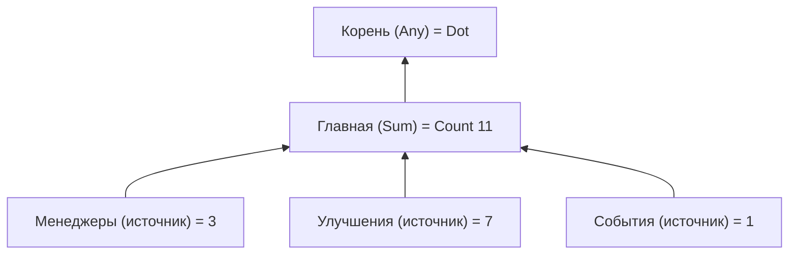

# Бейджи

`Foundation.Badges` позволяет строить иерархию бейджей уведомлений и обновлять их при изменении состояния.
Игровые подсистемы сообщают значения через `IBadgeSource`, а интерфейс получает их через `IBadgeService` и не
опрашивает подсистемы напрямую.



| Тип | Роль |
| --- | --- |
| `BadgeId` | [Типизированный идентификатор](../systems/typed-ids). |
| `BadgeDefinition` | Узел: идентификатор, необязательный родитель, `BadgeAggregation` (`None`, `Any`, `Sum`, `Max`). |
| `BadgeCatalog` | ScriptableObject с определениями (**Create → Foundation → Badges → Catalog**). |
| `IBadgeSource` | Предоставляется подсистемой: `Id`, `Value` и событие `Changed`. |
| `IAcknowledgeableBadgeSource` | Источник с разовым содержимым «New»: `Acknowledge()`. |
| `IBadgeService` | `Get(id)`, `Observe(id)`, `RegisterSource`, `UnregisterSource`, `Acknowledge(id)`. |
| `BadgeValue` | `None`, `Dot`, `Count(n)` или `New`. |

## Подключение {#wiring}

Установите сервис с каталогом, затем регистрируйте каждый источник, когда его подсистема становится готова.

```csharp compile
using System;
using Foundation.Badges;
using Foundation.DI;
using Foundation.Reactive;

public sealed class ManagersBadgeSource : IBadgeSource, IDisposable
{
    private readonly Func<int> _availableManagers;

    public ManagersBadgeSource(Func<int> availableManagers) => _availableManagers = availableManagers;

    public BadgeId Id => BadgeId.From("managers");

    // Вычисляется по актуальному состоянию подсистемы.
    public BadgeValue Value => BadgeValue.FromCount(_availableManagers());

    public event Action Changed;

    // Вызывайте событие, только если состояние могло измениться. Опрос по таймеру не выполняется.
    public void NotifyChanged() => Changed?.Invoke();

    public void Dispose() => Changed = null;
}

public static class BadgeCatalogExample
{
    public static BadgeCatalog Create() => BadgeCatalog.Create(new[]
    {
        new BadgeDefinition(BadgeId.From("root"), aggregation: BadgeAggregation.Any),
        new BadgeDefinition(BadgeId.From("main"), BadgeId.From("root"), BadgeAggregation.Sum),
        new BadgeDefinition(BadgeId.From("managers"), BadgeId.From("main")),
    });
}

public sealed class ManagersFeature : IDisposable
{
    private readonly IBadgeService _badges;
    private readonly ManagersBadgeSource _source;
    private int _available = 3;

    public ManagersFeature(IBadgeService badges)
    {
        _badges = badges;
        _source = new ManagersBadgeSource(() => _available);
        _badges.RegisterSource(_source);
    }

    public void OnManagerBecameAvailable()
    {
        _available++;
        _source.NotifyChanged();
    }

    public void Dispose() => _badges.UnregisterSource(_source);
}

public sealed class BadgeIcon : IDisposable
{
    private readonly IDisposable _subscription;

    public BadgeIcon(IBadgeService badges)
    {
        // Сразу передаёт текущее значение, а затем — каждое изменение.
        _subscription = badges.Observe(BadgeId.From("managers")).Subscribe(Render);
    }

    public void Dispose() => _subscription.Dispose();

    private void Render(BadgeValue value)
    {
        // Отобразите пустое состояние, точку, число или "New" в зависимости от value.Kind.
    }
}
```

`new BadgeInstaller(catalog)` в списке установщиков подсистем регистрирует каталог и `BadgeService` как
`IBadgeService`.

## Правила {#rules}

- **Идентификатор бейджа принадлежит одному источнику.** Дубликаты источников и определений отклоняются, а
  неизвестные идентификаторы бросают исключение, так что сломанный контент заметен при разработке.
- **Граф — это лес.** У каждого определения не более одного родителя; отсутствующие родители и циклы
  отклоняются.
- **Агрегация.** `Any` даёт `Dot`, когда что-то активно, `Sum` складывает счётчики, `Max` берёт наибольший,
  `None` использует только собственный источник узла. `Dot` или `New` вносят единицу в числовой агрегат.
  Счётчики насыщаются на `int.MaxValue`; `FromCount(0)` и отрицательные значения становятся `None`.
- **Обновления проходят только по изменённому пути.** Изменение пересчитывает изменённый узел и поднимается по
  предкам, пока значение не перестанет меняться. Независимые ветви не затрагиваются.
- **Подтверждение.** Для разового содержимого `New` реализуйте `IAcknowledgeableBadgeSource` и вызывайте
  `Acknowledge(id)`. Состояние подтверждения принадлежит источнику и сохраняется через ваши
  [сохранения](../app/save). Ядро бейджей не создаёт файлов, не использует `PlayerPrefs` и не угадывает, когда
  содержимое было прочитано.

## Представление {#presentation}

Пакет не поставляет компонент представления бейджа. Точка, счётчик или «New», их рендерер текста и локализованная подпись «New»
принадлежат вашему слою представления. Представление подписывается при включении и освобождает подписку при
выключении.
