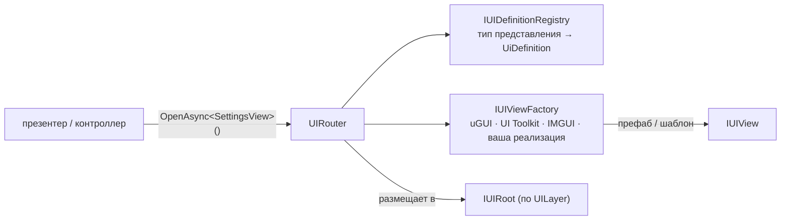

# UI-роутер

`IUIRouter` открывает, закрывает и заменяет представления по их определениям. Он не зависит от UI-системы:
`IUIViewFactory` создаёт представление из `UiDefinition`, а роутер управляет его показом и скрытием через
`ShowAsync` и `HideAsync`. Каждый роутер владеет собственным стеком навигации, кэшем и корневым объектом.



| Тип | Роль |
| --- | --- |
| `IUIView` | Управляет показом и скрытием представления через `ShowAsync` и `HideAsync`. Анимацию выполняйте внутри этих методов. |
| `UiDefinition` | Описывает представление: его идентификатор и источник `IUIViewSource`, слой `UILayer`, политику кэширования `UICachePolicy` и параметры `BlockInput`, `AllowBack`, `AllowDuplicates`. |
| `IUIDefinitionRegistry` | Сопоставляет тип представления с его описанием, поэтому `OpenAsync<TView>()` не требует передавать описание при каждом открытии. |
| `UILayer` | `FullScreen`, `Overlay`, `Popup`. Решает, под какой корневой объект помещается представление. |
| `UICachePolicy` | `DestroyOnClose` или `KeepAlive` (экземпляр скрывается и переиспользуется при следующем открытии). |
| `UiArgs` | Словарь аргументов, передаваемых при открытии. Представление, реализующее `IUIArgsReceiver`, получает их в `SetArgs`. |
| `IUIBackHandler` | Интерфейс для представления, которое само обрабатывает кнопку «Назад». |
| `IUIViewFactory` | Создаёт представления и `IUIViewInstance`, который отвечает за уничтожение представления. |
| `IUIRoot` | Определяет корневые объекты по слоям, в которые помещаются экземпляры. `TransformUIRoot` (корни экранов и всплывающих окон) и `LayerUIRoot` (один явный слой). |

## Описание и открытие представлений {#defining-and-opening-views}

```csharp compile
using System.Threading;
using Cysharp.Threading.Tasks;
using Foundation.Content;
using Foundation.DI;
using Foundation.UI;
using Foundation.UI.UGui;
using UnityEngine;

public sealed class SettingsView : MonoBehaviour, IUIView, IUIArgsReceiver
{
    public string Section { get; private set; } = "general";

    public void SetArgs(UiArgs args)
    {
        if (args.TryGetValue<string>("section", out var section))
            Section = section;
    }

    public UniTask ShowAsync(CancellationToken cancellationToken = default)
    {
        gameObject.SetActive(true);
        return UniTask.CompletedTask;
    }

    public UniTask HideAsync(CancellationToken cancellationToken = default)
    {
        gameObject.SetActive(false);
        return UniTask.CompletedTask;
    }
}

public sealed class HomeView : MonoBehaviour, IUIView
{
    public UniTask ShowAsync(CancellationToken cancellationToken = default)
    {
        gameObject.SetActive(true);
        return UniTask.CompletedTask;
    }

    public UniTask HideAsync(CancellationToken cancellationToken = default)
    {
        gameObject.SetActive(false);
        return UniTask.CompletedTask;
    }
}

// Ссылки на корневые объекты сцены передаются корневым компонентом, который владеет сценой.
public sealed class UiInstaller : IFeatureInstaller
{
    private readonly Transform _screenRoot;
    private readonly Transform _popupRoot;

    public UiInstaller(Transform screenRoot, Transform popupRoot)
    {
        _screenRoot = screenRoot;
        _popupRoot = popupRoot;
    }

    public void Install(IServiceRegistry registry)
    {
        var definitions = new UIDefinitionRegistry();
        definitions.Register<HomeView>(new UiDefinition(
            "home", new AddressViewSource("ui/home"), UILayer.FullScreen, UICachePolicy.KeepAlive, blockInput: false, allowBack: false));
        definitions.Register<SettingsView>(new UiDefinition(
            "settings", new AddressViewSource("ui/settings"), UILayer.Popup, UICachePolicy.DestroyOnClose, blockInput: true, allowBack: true));

        registry.RegisterInstance<IUIDefinitionRegistry>(definitions);
        registry.Register<UIRouterFactory>(ServiceLifetime.Singleton).As<IUIRouterFactory>();
        registry.Register(
            resolver => resolver.Resolve<IUIRouterFactory>().Create(new TransformUIRoot(_screenRoot, _popupRoot)),
            ServiceLifetime.Singleton);
    }
}

public sealed class NavigationExample
{
    private readonly IUIRouter _router;

    public NavigationExample(IUIRouter router) => _router = router;

    public async UniTask RunAsync()
    {
        await _router.ReplaceAsync<HomeView>();

        var args = new UiArgs(new System.Collections.Generic.Dictionary<string, object> { ["section"] = "audio" });
        var settings = await _router.OpenAsync<SettingsView>(args);

        await _router.CloseAsync(settings);
    }
}
```

`UIRouterFactory` создаёт роутеры с общим реестром определений, провайдером ресурсов, инжектором и фабрикой
экземпляров. Повторный вызов `Create(root)` создаёт **второй роутер** со своим стеком и корнем, например для
отображения интерфейса в отдельном контейнере. `LayerUIRoot` ограничивает его одним слоем и выбрасывает исключение,
если открыть представление другого слоя.

## Правила работы {#behavior-to-know}

`KeepAlive` нельзя сочетать с `AllowDuplicates`; такая конфигурация считается ошибочной. Если нужны несколько
экземпляров, используйте `DestroyOnClose`. Открытие или закрытие фиксируется, когда `ShowAsync` или `HideAsync`
представления успешно возвращается, даже если к этому моменту токен вызывающего уже отменён. С этого момента отменить
этот результат может только `Dispose`. Если метод представления выбрасывает исключение или отменяется до возврата,
операция не фиксируется: неудачное скрытие сохраняет представление за роутером, и закрытие можно повторить. Если
фабрика поздно вернёт уже не нужное представление, роутер освободит его, не показывая.

- **`OpenAsync`** добавляет представление в стек и показывает его. Повторный вызов для уже открытого определения,
  которое запрещает дубликаты, обновляет аргументы и показывает существующий экземпляр. Успешный показ фиксирует
  открытие в обоих случаях, поэтому отмена, пришедшая после него, не превращает вызов в ошибку.
- **`ReplaceAsync`** сначала показывает выбранное представление, затем скрывает остальные и перемещает цель на вершину
  стека. Во время перехода оба представления могут быть видны одновременно. Если показ цели завершается ошибкой или
  отменой до успешного возврата, остальные представления остаются открыты. Успешный показ фиксирует цель: отмена после
  него останавливает оставшиеся скрытия, но цель остаётся открытой, поэтому вызов может сообщить об отмене при уже
  показанной цели. Каждое скрытие — отдельный шаг: часть представлений может быть уже закрыта, остальные остаются
  открытыми, и их можно закрыть позже. Если скрывать больше нечего, отмена после показа цели не отменяет вызов.
- **`CloseAsync(view)`** скрывает представление и уничтожает его при `DestroyOnClose`. Успешное скрытие фиксирует
  закрытие, даже если отмена вызывающего пришла к этому моменту. Если `HideAsync` завершается ошибкой или отменой,
  представление остаётся в стеке, и закрытие можно повторить.
- **`ClearAsync()`** закрывает представления с вершины стека по одному. Каждое успешное скрытие убирает своё
  представление, поэтому ошибка или отмена посреди операции оставляет уже скрытые закрытыми, а остальные открытыми.
  Частичный результат возможен.
- **`BackAsync()`** сначала передаёт обработку верхнему представлению, если оно реализует `IUIBackHandler`; флаг
  `AllowBack` на это не влияет. Если обработчика нет, представление закрывается только при `AllowBack`. Метод возвращает
  `false`, если закрывать нечего; тогда платформа выполняет действие по умолчанию (см. `AndroidBackButton` ниже).
  Закрытие через Back подчиняется тому же правилу: успешный `HideAsync` фиксирует закрытие.
- **`Dispose()`** завершает работу роутера, а не выполняет навигацию: отменяет операции, очищает стек и кэш и
  освобождает отслеживаемые экземпляры после завершения выполняющихся `ShowAsync`, `HideAsync` и обработчиков Back.
  После этого роутер непригоден.
- **Операции выполняются последовательно** под внутренней блокировкой. Метод `HandleBackAsync` вызывается вне
  блокировки, поэтому обработчик может сам открывать и закрывать представления. Следствие: представление не должно
  ожидать (`await`) операцию роутера внутри собственных `ShowAsync` или `HideAsync`: эта операция будет ждать
  блокировку, которую ещё удерживает операция самого представления. Запускайте её без ожидания или после того, как
  показ завершится.
- **`HasOpenViews(layer)`** сообщает, есть ли что-то открытое в слое.
- `BlockInput` — данные определения для вашего слоя представления (например, фона, блокирующего ввод). Сам
  роутер их не интерпретирует.
- Перед показом `IGameObjectInjector` внедряет в представление зависимости из области DI-контейнера. Поэтому каждый
  `MonoBehaviour`, реализующий `IServiceResolverClient`, получает свои сервисы ([DI](../core/di#injecting-monobehaviours)).

## Всплывающие окна {#popups}

Всплывающее окно — обычное представление на слое `UILayer.Popup`. Методы `PopupDefinitions.FromAddress(viewId, address)`
и `FromPrefab(viewId, prefab)` создают определение с типичными настройками: окно уничтожается при закрытии,
блокирует ввод, закрывается кнопкой «Назад» и допускает несколько экземпляров.
`router.OpenPopupAsync<TView>(definition, args)` открывает одно и возвращает `PopupHandle<TView>`:

```csharp compile
public sealed class ConfirmPopup : MonoBehaviour, IUIView
{
    public UniTask ShowAsync(CancellationToken cancellationToken = default)
    {
        gameObject.SetActive(true);
        return UniTask.CompletedTask;
    }

    public UniTask HideAsync(CancellationToken cancellationToken = default)
    {
        gameObject.SetActive(false);
        return UniTask.CompletedTask;
    }
}

public sealed class PopupExample
{
    private static readonly UiDefinition Confirm = PopupDefinitions.FromAddress("confirm", "ui/confirm");

    private readonly IUIRouter _router;

    public PopupExample(IUIRouter router) => _router = router;

    public async UniTask AskAsync(CancellationToken cancellationToken)
    {
        using var popup = await _router.OpenPopupAsync<ConfirmPopup>(Confirm, cancellationToken: cancellationToken);

        // popup.View — это ConfirmPopup. Dispose закрывает его без ожидания; CloseAsync() ожидает завершения закрытия.
        await UniTask.Delay(1000, cancellationToken: cancellationToken);
        await popup.CloseAsync();
    }
}
```

## Кнопка «Назад» Android {#android-back}

`AndroidBackButton` из сборки `Foundation.UI.InputSystem` доступен при установленном пакете Input System. Он
передаёт Escape или кнопку «Назад» Android в `IUIRouter.BackAsync` области, где зарегистрирован. Если открытых
представлений нет, нажатие обрабатывает сама платформа. Зарегистрируйте его через
`registry.RegisterEntryPoint<AndroidBackButton>()`.

## Вкладки {#tabs}

`ITabGroup` и `ITabSwitchHandler` — контракты для элемента выбора и для того, что запускает выбор.
`UITabGroup` для uGUI вызывает все зарегистрированные обработчики с данными `TabSwitch`: предыдущей и новой
вкладкой, направлением перехода и задачей анимации кнопок (`UniTask`). Переключение завершается, когда завершатся
все обработчики. Их можно указать рядом с группой в `switchHandlers` или добавить из кода через
`AddSwitchHandler`. Сама группа не отвечает за содержимое вкладок, загрузку, раскладку и правила блокировки.

`ITabGroupTrySelect` — дополнительный контракт для группы, умеющей сообщить, что выбор не удалось начать.
Метод `UITabGroup.TrySelectAsync` сразу возвращает `false`, пока выполняется другой переход, и не ставит запрос в
очередь.
`SelectAsync` в этой же ситуации сохраняет прежнее поведение: возвращается, ничего не выбрав и не сообщив об этом.
Когда группа свободна, повторный выбор уже выбранной вкладки возвращает `true` и не запускает переход, поэтому
события не возникают.

```csharp compile
public sealed class ShopView : MonoBehaviour, IUIView
{
    public UniTask ShowAsync(CancellationToken cancellationToken = default)
    {
        gameObject.SetActive(true);
        return UniTask.CompletedTask;
    }

    public UniTask HideAsync(CancellationToken cancellationToken = default)
    {
        gameObject.SetActive(false);
        return UniTask.CompletedTask;
    }
}

public sealed class ContentTabHandler : ITabSwitchHandler
{
    private readonly IUIRouter _router;

    public ContentTabHandler(IUIRouter router) => _router = router;

    public async UniTask HandleAsync(TabSwitch tabSwitch, CancellationToken cancellationToken)
    {
        if (tabSwitch.TabId == "shop")
            await _router.ReplaceAsync<ShopView>(cancellationToken: cancellationToken);
        else
            await _router.ReplaceAsync<HomeView>(cancellationToken: cancellationToken);

        await tabSwitch.SelectionVisuals;
    }
}

public sealed class TabsBootstrap
{
    public static async UniTask StartAsync(UITabGroup tabs, IUIRouter router, CancellationToken cancellationToken)
    {
        tabs.AddSwitchHandler(new ContentTabHandler(router));
        await tabs.SelectInitialAsync(cancellationToken);
    }
}
```

`SelectedTabChanged` вызывается в начале переключения, `SelectedTabSettled` — после завершения всех обработчиков и
анимации кнопок. К этому моменту выбор уже зафиксирован: исключение из подписчика `SelectedTabSettled` доходит до
вызывающего, а выбранная вкладка и содержимое, переключённое обработчиками, остаются как есть. Выбор, запущенный
внутри любого из этих событий, выполняется, пока переход, вызвавший событие, ещё не завершён: `TrySelectAsync` вернёт
там `false`, а `SelectAsync` отбросит запрос.

`UITabItem` показывает состояние кнопки, заданное его идентификаторами состояний; проект может переопределить это
состояние и запретить нажатие.

## Реализации роутера {#backends}

`UIRouter` не зависит от конкретной UI-системы. Источник `IUIViewSource` в определении указывает, откуда
загрузить представление. Фабрика каждой UI-системы обрабатывает свои источники и отклоняет остальные.

| Реализация | Сборка | Define | Источники |
| --- | --- | --- | --- |
| uGUI | `Foundation.UI.UGui` | нет | `PrefabViewSource` (ссылка на префаб) или `AddressViewSource` (загружается через `IAssetProvider`) |
| UI Toolkit | `Foundation.UI.Toolkit` | `FOUNDATION_UITOOLKIT` | `UiToolkitTemplate` (UXML или дерево, построенное в коде) |
| IMGUI | `Foundation.UI.Imgui` | `FOUNDATION_IMGUI` | `ImguiTemplate`, рисуется `ImguiHost` |

```csharp
public sealed class ToolkitSettingsView : UiToolkitView { }

// UI Toolkit: представления — это деревья элементов внутри корневого контейнера.
registry.RegisterInstance<IUIViewFactory>(new UiToolkitViewFactory(new UiToolkitRoot(screens, popups)));
var source = new UiToolkitTemplate(tree, () => new ToolkitSettingsView());   // VisualTreeAsset или Func<VisualElement>
var definition = new UiDefinition("settings", source, UILayer.Popup, UICachePolicy.DestroyOnClose, blockInput: true, allowBack: true);
```

Чтобы использовать другую UI-библиотеку, реализуйте `IUIViewFactory` и `IUIView` для неё и зарегистрируйте
фабрику. Навигация, стек кнопки «Назад», кэширование и аргументы продолжат работать без изменений. Разные
роутеры и области DI-контейнера могут использовать разные UI-системы.

## Всплывающие подсказки {#tooltips}

`TooltipPlacement.Compute` рассчитывает положение подсказки по прямоугольнику цели, размеру подсказки, границам
контейнера, зазору и отступу стрелки. Результат `TooltipLayout` содержит центр, выбранную сторону, положение
стрелки и признак, помещается ли подсказка. Сначала проверяется предпочтительная сторона, затем верх или низ,
после этого — левая или правая сторона. Итоговая позиция ограничивается заданными границами.

Расчёт не зависит от UI-библиотеки, но предполагает, что **y растёт вверх** (соглашение uGUI): «сверху» —
сторона с большим y. UI Toolkit и IMGUI считают y вниз, поэтому отразите прямоугольники на входе, а центр на
выходе; стороны при этом сохранят визуальный смысл.

```csharp compile
using Foundation.UI;
using UnityEngine;

public static class ToolkitTooltipPlacement
{
    public static TooltipLayout Compute(Rect target, Vector2 size, Rect bounds, TooltipSide preferred = TooltipSide.Auto)
    {
        var layout = TooltipPlacement.Compute(Flip(target), size, Flip(bounds), gap: 8f, arrowMargin: 12f, preferred);
        return new TooltipLayout(
            new Vector2(layout.Center.x, -layout.Center.y),
            layout.Side,
            layout.Side == TooltipSide.Left || layout.Side == TooltipSide.Right ? -layout.ArrowOffset : layout.ArrowOffset,
            layout.Fits);
    }

    private static Rect Flip(Rect rect) => new(rect.x, -rect.yMax, rect.width, rect.height);
}
```

`TooltipBubble` для uGUI размещает подсказку на экране. `SetAnchor(target, side, showArrow)` помещает её рядом
с целью и направляет стрелку. `SetAvoid` задаёт область, которую нужно обходить. После расчёта раскладки
вызывайте `Place(space, deltaTime)` каждый кадр: блок плавно переместится к нужной позиции, будет следовать за
целью и останется в безопасных границах. Если размер текста изменился, вызовите `Remeasure()` после перестроения
раскладки. Отдельного сервиса подсказок нет: `TooltipBubble` принадлежит представлению.
