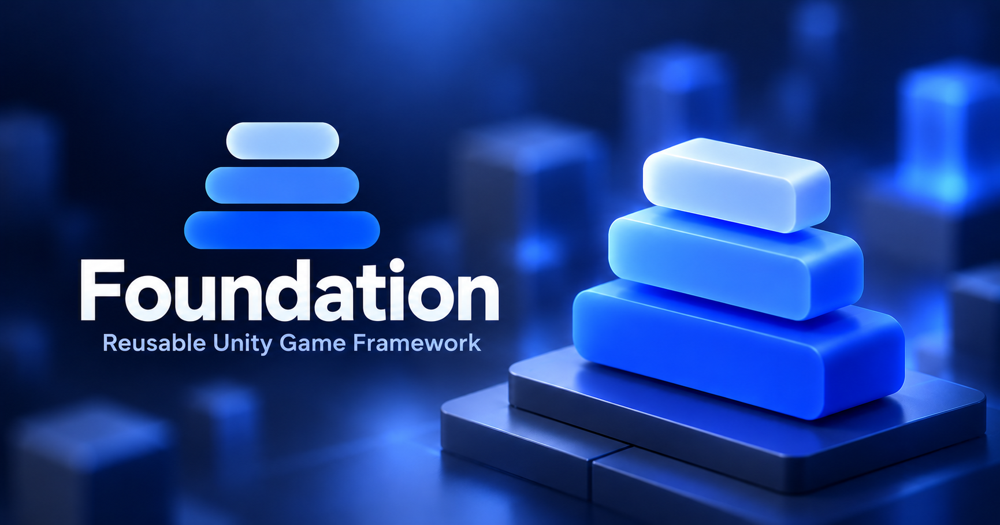

<h1 align="center">
  
</h1>

<p align="center">A reusable, game-agnostic application foundation for Unity 6000.5+.</p>

<p align="center">
  <a href="https://fzfking.github.io/foundation/"></a>
  
  <a href="LICENSE"></a>
</p>

---

## Table of contents

- [Overview](#overview)
- [Install](#install)
- [Minimal composition root](#minimal-composition-root)
- [Games built with Foundation](#games-built-with-foundation)
- [Stability](#stability)
- [Contributing](#contributing)
- [License](#license)

---

## Overview

Foundation (`com.fzfking.foundation`) is a reusable application foundation for Unity 6000.5 or newer. It provides
startup, service scopes, persistence and presentation infrastructure. Foundation includes minimal reactive value and
event-stream types; each project can use them directly or bridge an external reactive library, and can choose its own DI
container, serializer and tween library.

- **Ports and adapters.** Optional third-party integrations are accessed through ports in `Foundation` and optional
  adapter assemblies. [UniTask](https://github.com/Cysharp/UniTask) is the required async dependency and appears
  directly in package APIs.
- **Game-independent infrastructure.** Economy, progression, combat rules and content schemas belong to your project.
- **Explicit feature registration.** Each feature provides an `IFeatureInstaller` that registers its services through
  `IServiceRegistry`. The composition root applies these installers without exposing a specific DI container to them.

### What's included

| Area | What it gives you |
| --- | --- |
| Composition | DI port, feature installers, entry points, boot pipeline, root scope |
| Contexts | One running game at a time, with its own scope, configs and save namespace; loadable game modules |
| Messaging | Commands, queries and events with development tracing |
| Logic | State machine, fixed-step simulation, scheduler, requirements, rewards, feature flags |
| Persistence | Segmented save: each feature owns its slice |
| Data and content | Config groups, asset provider, localization |
| UI | Backend-neutral layered router, uGUI components, tabs, tooltips, badges, feedbacks |
| Systems | Audio, pooling, typed IDs, scripted sequences, tutorials, motion, and asynchronous object spawning with a per-frame integration-time budget |
| Release | Client version policy and remote release configuration |
| Mobile services | Ads, IAP, identity, notifications, cloud save, analytics backends |

## Install

Foundation does not compile without [UniTask](https://github.com/Cysharp/UniTask). Add it separately to the Unity project (Package Manager → **Add package from git URL**):

```text
https://github.com/Cysharp/UniTask.git?path=src/UniTask/Assets/Plugins/UniTask
```

Then add Foundation, pinned to a release tag:

```text
https://github.com/fzfking/foundation.git#0.8.0
```

or in `Packages/manifest.json`: `"com.fzfking.foundation": "https://github.com/fzfking/foundation.git#0.8.0"`.

Finally install whichever adapters you use. The [adapter
table](https://fzfking.github.io/foundation/adapters/overview#installing-a-dependency) lists the package URLs and the
versions tested. Libraries delivered as NuGet DLLs are switched on by a define: after adding them, run **Foundation →
Bootstrap New Project → Finish Setup (Verify And Set Defines)**.

## Minimal composition root

```csharp
public sealed class GameScope : VContainerRootScope<GameEntryPoint>
{
    protected override IReadOnlyList<IFeatureInstaller> FeatureInstallers { get; } = new IFeatureInstaller[]
    {
        new GoldInstaller(),                           // your own: IServiceRegistry in, registrations out
    };

    protected override void PrebindActions(IServiceRegistry registry) => registry.RegisterMessaging();
}

public sealed class GoldInstaller : IFeatureInstaller
{
    public void Install(IServiceRegistry registry)
    {
        registry.Register<GoldWallet>(ServiceLifetime.Singleton);
        registry.RegisterCommandHandler<AddGoldCommand, AddGoldCommandHandler>();
    }
}
```

The [quick start](https://fzfking.github.io/foundation/getting-started/quick-start) builds this up into a running scope.

## Games built with Foundation

- [Vampires World Idle](https://play.google.com/store/apps/details?id=com.freedominteractive.vampireWorldIdle) by Freedom Interactive Studios: a vampire idle tycoon for Android.

Made a game with Foundation? Open an issue or a pull request to add it here.

## Stability

Foundation follows [semantic versioning](https://semver.org). While the version is `0.x`, the API is not frozen:

- a minor release (`0.8` → `0.9`) may contain breaking changes, a patch release (`0.8.0` → `0.8.1`) will not;
- every breaking change is listed in [CHANGELOG.md](CHANGELOG.md) with the replacement API;
- the ports in `Foundation` (messaging, save, content, UI router, DI) are the parts intended to be frozen at `1.0`;
  adapters and the `Foundation.GameFramework.*` mobile backends depend on third-party SDKs and may change faster;
- pin a release tag (`#0.8.0`) rather than `main`.

## Contributing

See [Contributing.md](Contributing.md) for contribution guidelines.

## License

MIT, see [LICENSE](LICENSE).
